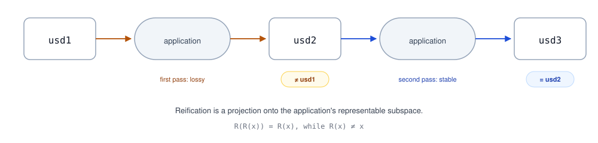
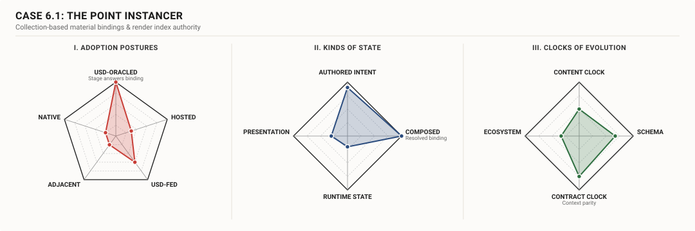
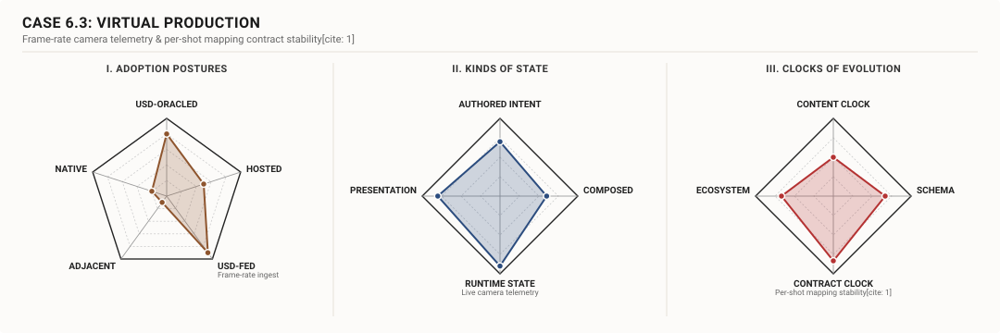
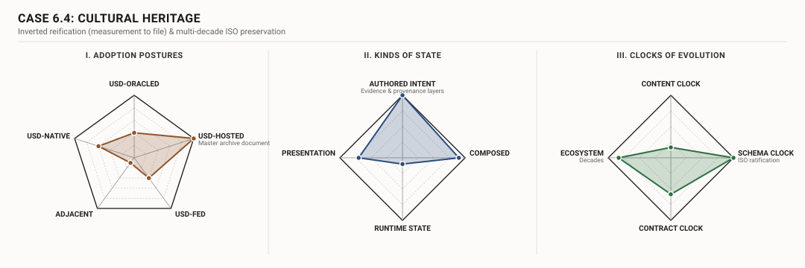

# Reification, Oracles, & Evolution
### A practical rubric for OpenUSD adoption

---

**Abstract.** Adoption of USD typically revolve around two distinct concepts; USD as a file format, and USD as a runtime composition engine. This essay argues that distinction oversimplifies the implications of adoption, and that USD is better understood as system, in terms of three distinct modalities: reification, oracle, and evolution. Reification is a lossy projection between application data and schemata; an oracle is an authority of composition as it stands, and evolution is a question of jurisdiction over change. Adoption difficulty arises from assigning an operational mode of USD inappropriately to a usage domain. This essay proposes an adoption rubric: an ontology, a taxonomy of modes, and tests the rubric against production cases in VFX, games, virtual production, and cultural heritage.

---

## 1. What we hear when we say "adopt USD"

I've spent more than a decade working to advance OpenUSD adoption in many fields and application domains. I have a lot of context and domain knowledge, so some things that seem intuitive and natural to me are not always so obvious to my audience. Lately I have been trying to "hear" what other people hear when I talk about adopting OpenUSD. I think the message that's often heard is a sort of naive and prescriptive *make everything USD*, that the goal is a USD-native application, where the composition engine is at the center of the object model, the runtime is built on the stage, and the whole program is essentially a view on a layer stack.

Applications like that are emerging rapidly, but the important case to reason about is the adoption of USD into an established, mature pipeline and tool set that is in active use in real production. Modern pipelines in active production typically compose USD, query it, and translate results into native datastructures; they then operate and transform their data in unique and specialized ways, and ultimately commit those edits back to USD layers.

The paper [*Last Mile and Interchange* (Porcino, 2025)](https://nickporcino.com/papers/lastmile-v2/) (LMI) made a case for a new ontology for 3d file formats, arguing that we have been asking one artifact to two different jobs that are only superficially similar - carrying authorial intent between applications, and delivering finished assets to an end point. That confusion, not any particular format, was the source of much of the pain around the selection and deployment of various fileformats. The taxonomy LMI laid out was useful in turning a religious argument into an engineering discussion.

LMI classified formats by intent; this article attempts to do the same for scene description, asking **what do we ask a scene description to do *inside* an application**. In order to help reason about that question, we will develop a rubric for USD adoption, from an ontology of operational modes and a set of characteristic taxonomies.

## 2. The Ontology

### 2.1 Reification

> **Reification** - the production of a concrete, resolved representation from an abstract, composed description.

Reification in computer science is the process of making a thing concrete. It is what happens when information moves between USD and an application. It is the bake, the import, the instantiation; and also, the write-back, the export, the save. Reification is **bidirectional without being invertible.** Consider this cycle:

In this cycle, the application is lossy, so reading `usd1` and writing `usd2` loses whatever information the application cannot represent. We expect that `usd1 ≠ usd2`. In the second pass through the application there's nothing left to lose so `usd2` is in the application's canonical image, so we expect that `usd2 = usd3`.

That is the defining property: **Reification is a projection onto the application's representable subspace.** It is idempotent, not invertible: `R(R(x)) = R(x)`, while `R(x) ≠ x`.

Four properties of USD reification logically follow:

- **It is eager.** It resolves up front, at load, or at a declared change boundary — an explicit synchronization point (such as a scene load, a user-initiated bake command, or a commit checkpoint) where data explicitly crosses the reification threshold rather than syncing continuously.
- **It is lossy by design.** Reification consumes choice points. The write-back does not restore choices the forward pass consumed. New choices are created in application's idiom. This is a useful property, not a flaw.
- **It is convergent.** One round trip loses information, subsequent round trips do not.
- **It is deterministic.** For a fixed composition, the same pass produces the same result.

A clear diagnostic signal against a well structured USD adoption occurs when `usd2 ≠ usd3` - the mapping fails the *convergence* property or the *determinism* property or both. The composition and the reified data are out of sync; the application will report bad state, and the consequence of non-deterministic and stateful mappings is miserable debugging situations.

Understanding the properties of reification, and designing for them is the path to success.

## 2.2 Oracle

> An **oracle** is an authority that answers questions about composed state, on demand.

An application can use USD as an oracle. *Given this path, this context, this opinion stack, what does the scene actually say?*

An oracle is not a file reader or an importer; these return or translate what was written. An oracle returns what a composition means, including opinions from all contributing layers to form a final result.

An Oracle has five properites:

- **It is lazy.** It resolves a single specific question, when asked.
- **It is partial.** It answers about a path, a property, or a relationship, but not the whole world.
- **It is context-relative.** An oracle is authoritative for a given layer stack, variant selection, and purpose. Asking in a different context might give a different, equally correct answer.
- **It is authorative.** Within its context, it is the answer - there is no second opinion.
- **It has no memory.** The oracle answers only for its context; whether two compositions agree is a question to ask of the answers, not the oracle.

The fifth property is the characteristic failure mode of the oracle: querying the oracle in one context and consuming the answer in another, or relying on external diffs to discover agreement.

## 2.3 Evolution

> **Evolution** is the persistence and change of the described world over time.

There are two forms of evolution that impact USD integration.

- **Authored evolution** is change by *intent*. New versions, overrides, variants, layering, animated values. USD composition system exists to let many hands cooperatively and collaboratively change one world without destroying each other's work.
- **Emergent evolution** is change by *process*. Simulation, deformation, gameplay, interaction; these are the domain of the runtime. This change is not authored and is directly composable.

The characteristic failure mode of evolution imposes a **category error:** putting emergent state into USD, or freezing out authored state. Recording emergent state asks a composition engine to be a database; baking authored state turns a live description into a dead export.

## 2.4 The duality of reification and the oracle

An oracle is a *lazy reifier*, providing one fact, when asked. A reifier is an *eager oracle*: resolve everything, up front, all at once. Reification keeps the answers, and keeping the answers makes reification lossy. The oracle discards any provided answers, since it must answer fresh when asked, it will therefore always give a true answer.

> Reification converges because it persists; the oracle stays true because it forgets.

Reification is a projection - the data USD carries lands in the application's reprsentatable subspace. The oracle has no state, so every answer is true to its composition and context.

The fundamental question of USD adoption then, is not "should we use USD or not?" It is this set of questions applicable to each piece of data:

- Where on the eager-lazy spectrum does it belong?
- What invalidates the answer?
- Who owns the invalidation?

**Evolution** makes this a moving target. Eager answers go stale when the world changes. Lazy answers drift when the cache is wrong. Answering the questions is the basis of the engineering design of USD adoption. Figure 2 illustrates the choices:

The left column is authored change, and belongs to USD. The right column is emergent change, and belongs to the application. Note the Eager-Emergent quadrant: **baking emergent state into USD is a last-mile operation.** This operation imposes an opinion and discards the process; that is legitimate — *Alembic* has made a long and respectable career of it. Beware the potential for a **category error** however. We mustn't pretend the bake is the process, or that the cache is the world.

## 3. Taxonomy I: adoption postures

The ontology we have established describes the operational modes of USD adoption. We will now apply the ontology to derive our characteristic taxonomies.

The first taxonomy describes where an application chooses to put its object model. Here are five postures, in rough order of ambition:

| Posture          | Where the object model lives | What USD does | Characteristic failure |
|------------------|------------------------------|---------------|------------------------|
| **USD-native**   | In USD                       | Everything | A runtime rebuilt inside a composition engine |
| **USD-hosted**   | In USD, as a document        | Holds the document; the app edits it | Every edit becomes a composition edit |
| **USD-fed**      | In the application           | Boundary format | Round-trip loss; the boundary becomes a wall |
| **USD-oracled**  | In the application           | Authoritative answers | Cache/oracle divergence |
| **USD-adjacent** | In both, kept in sync        | Sibling representation | Two sources of truth |

Some notes on the postures:

**USD-native** is the posture most people assume we are advocating, despite cutting against the grain of mature pipelines. It means the composition engine is in the hot path of every runtime operation, and the semantics of PCP — opinion strength, namespace resolution, composition arcs — become the semantics of the application. That is a coherent thing to build, but it is a very tall order for a mature existing pipeline and technology stack.

**USD-hosted** is right when the deliverable *is* the USD file. An authoring tool whose product is a layer stack should treat the stage as its document, the way a word processor treats a document. Taking this approach means that undo, transactions, and performance are composition problems, and the tool had better be designed for that from the start.

**USD-fed** is the classic import/export pattern. It is straightforward, and it is simultaneously very limited: the result is a last-mile relationship whether you call it that or not.

**USD-oracled** is the posture most mature heavily integrated production software will likely occupy at first. The application owns its runtime, its data structures, and its performance profile. It consults USD for authoritative answers about what the world is. Care must be taken that the cache and the oracle do not drift apart.

**USD-adjacent** is an anti-pattern. Two representations, kept in sync by translation, is not a posture so much as a debt schedule.

**The rule:** choose the posture per subsystem, don't aim for one posture suits all goals. A renderer, an editorial tool, and a game runtime can and should occupy different rows of this table at the same time.

## 4. Taxonomy II: kinds of state

Most arguments about USD adoption are really arguments about jurisdiction. The second taxonomy is should help settle these arguments.

| Kind of state          | Example | Jurisdiction | If misplaced |
|------------------------|---------|--------------|--------------|
| **Authored intent**    | opinions, overrides, variants, layering | USD | The world loses its edit history |
| **Composed state**     | the resolved material binding for a path | USD computes it; nobody stores it | Stale copies; silent divergence |
| **Runtime state**      | simulation, deformation, gameplay | The application | A composition engine asked to be a database |
| **Presentation state** | selection, camera, viewport, UI | The application, or an explicit session layer | Ephemeral data mistaken for truth |

**The rule: USD is the authority for what the world *is*, not for what the world *is doing*.**

That single sentence resolves the game-engine question, the simulation question, and most of the virtual-production question. It also explains why "USD-native runtime" feels like such an uncomfortable phrase: it proposes to force phenomenology into the definition of the world.

There are two importance nuances however.

First, presentation state can legitimately live in a USD layer — this is the purpose of ephemeral session layers. The power of the mechanisms are borrowed, but the jurisdiction over the state is not extended to the scene's canonical composition. Session layers can be saved but mustn't be regarded as content. If an authored choice is made in a session layer it should ultimately be migrated to an authoring layer.

Second, composed state is real state, but it is *derived*. It should be recomputed, not stored. Every time you persist or bake a composed answer, you have created a second oracle, and the second oracle will eventually disagree with the first.

## 5. Taxonomy III: clocks of evolution

The third taxonomy is about what can change in the USD ecosystem, and the potential hazards. Four clocks run concurrently in any USD integration.

| Clock         | What changes   | Owner | Failure if unversioned |
|---------------|----------------|-------|------------------------|
| **Content**   | the world      | production | Versions collide; nobody knows which world is current |
| **Schema**    | the vocabulary | schema authors, AOUSD | Silent misinterpretation of properties |
| **Contract**  | the mapping between USD and the app | the integrating team | The integration breaks on upgrade |
| **Ecosystem** | the tools      | everyone | The mapping works in one DCC and not another |

**The rule: careful versioning of each clock is critical.**

An application must track the evolution clocks, otherwise an application doesn't have an integration, it relies on coincidence to function.

## 6. Cases and consequences

### 6.1 The point instancer: an oracle problem

- **Taxonomy Signature:** Heavily USD-Oracled, anchored in Composed State, with acute vulnerability on the Contract Clock.

A recent bug: collection-based material bindings resolved correctly in the composition stage but failed in the render index for point-instanced geometry. The tempting debug path is to assume the instancer's index is the ground truth, and hunt for a malformed slot.

When viewed through our ontology, this is a classic failure of Taxonomy II (State Jurisdiction) and Taxonomy III (Clocks). The truth is not the render index; the truth is the composition. The bug occurred because a secondary render-index cache acted as a second oracle that had drifted from the stage's composition context. Treating USD as an authoritative oracle, and maintaining strict Contract Clock parity between what the stage computes and what the consumer queries, resolves the divergence.

### 6.2 The game: an evolution problem

- **Taxonomy Signature:** Governed by USD-Fed boundary reification, split between initial Authored Intent and massive Runtime State, driven by a rapid Content Clock.

A game engine's initial state is authored intent, but its running state is emergent. USD is optimized for the former, and structurally wrong for the second.

Attempting to store evolving gameplay or physics simulation inside USD is a category error: it asks a composition engine to act as a real-time database. A successful pattern is a clean USD-Fed adoption posture where USD acts as the oracle for spawn state, followed by an eager reification boundary. Once inside the engine, runtime state belongs entirely to the application's native structures.

### 6.3 Virtual production: a contract problem

- **Taxonomy Signature:** Balanced on USD-Fed / USD-Oracled postures, heavily dependent on Runtime and Presentation State, with an existential reliance on the Contract Clock.

On a virtual production stage, the primary engineering challenge is not the scene content, but the mapping. Camera position, lens characteristics and settings, and stage metadata arrive as live telemetry that must land in the engine with stable, predictable semantics, at frame rate, directly in front of a director.

This workflow shares a deep structural lineage with cultural heritage because both are fundamentally reality-capture pipelines. When the mapping contract is treated as a versioned, tested artifact, the integration succeeds. When it is improvised per shot, the Contract Clock fractures, breaking the real-time pipeline.

### 6.4 Cultural heritage: a preservation problem

- **Taxonomy Signature:** Anchored in a USD-Hosted / USD-Native master file posture, dominated by Authored Intent (evidence vs. inference layers), and stretched across decades-long Schema and Ecosystem Clocks.

At museums like The Met, digital duplicates of masterworks like [van Gogh’s Sunflowers](https://www.metmuseum.org/perspectives/color-photography-standards-van-gogh-sunflowers) are built from photogrammetry, spectroscopy, and color calibration. Cameras, calibration matrices, and point clouds must remain permanently bound to their evidentiary data.

This domain inverts the usual software paradigm through three structural shifts:

1. **Inverted Reification:** Unlike a game where software projects data into an app, cultural heritage projects physical reality into USD. The physical object is ground truth; the capture pipeline is a lossy projection constrained by what instruments can measure.   
2. **Provenance over Presentation:** Following specialized schemata like UsdGeomBackPlateAPI, the scene separates raw evidence from derived inferences (such as reconstructed meshes). Overwriting evidence with baked, computed, or inferred data turns a scientific record into a mere assertion.   
3. **The Multi-Decade Horizon:** While virtual production shares heritage's reality-capture DNA, its operational telos is immediate and real-time. Cultural heritage inverts this: the runtime is merely a temporary means, while the file is the permanent end. Because the file must outlive its creators and software tools, the Ecosystem and Schema Clocks span decades, making AOUSD's ISO ratification an essential structural preservation mechanism.

## 7. Conclusion: Adoption with Intent

The historic friction in OpenUSD adoption is arguably not one of technology, but one of jurisdiction. Integration into existing pipelines without due consideration to the characteristics of its use in context invites complexity and technical debt. The rubric outlined in this essay—reification, oracle, and evolution—replaces dogmatic "USD-native" mandates with intentional, subsystem-level choices:

- **Reification** gives us a principled way to manage the lossy, convergent boundary where USD meets an application.
- **The Oracle** gives us a stateless, context-relative authority to answer what the world is without creating second-oracle drift.
- **Evolution** reminds us that jurisdiction over change — whether authored intent, runtime simulation, or multi-decade schema preservation — determines where state belongs.

Whether an integration's ultimate *telos* is an animated film, a high-speed game engine, a real-time virtual production stage, or a multi-decade cultural heritage archive, success comes from asking the right questions of your data: Where on the eager-lazy spectrum does it live, what invalidates it, and who owns the clock? When we answer those questions with discipline, USD ceases to be simply a disruptive new technology and fulfills its design intention to be a shared language for cooperative human intent.

**Nick Porcino,** (c)2026
written in california
