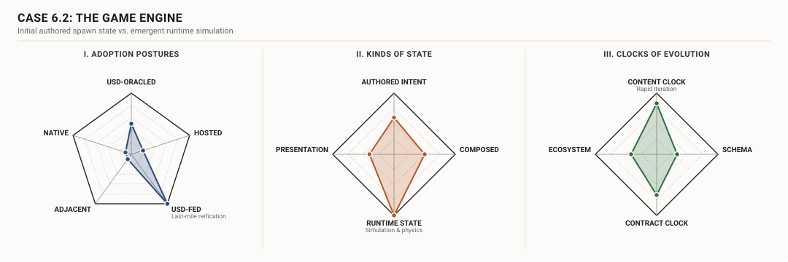
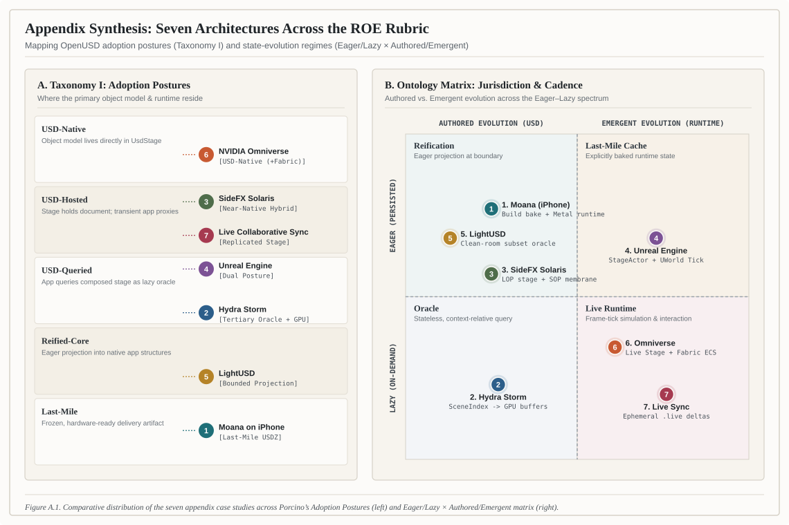

**Abstract.** Discussions around adoption of interchanging frameworks, such as OpenUSD for 3D scenes and OpenTimelineIO for editorial timelines, typically revolve around two distinct concepts: the interchange representation as a file format, and the framework as a runtime data and composition model. This monograph argues that this dichotomy oversimplifies the realities of adoption, and that structured interchange is better understood as a system with three distinct operational modalities: reification, oracle, and evolution. Reification is a lossy, idempotent projection between an application's native object model and shared schemata; an oracle is a stateless, context-relative authority over composed state; and evolution is a question of jurisdiction and clocks over change. Adoption failures rarely stem from missing features in a specification; rather, they arise from assigning an operational mode inappropriately to a usage domain, or leaving projection boundaries and invalidation contracts. Part I develops a general adoption rubric: an ontology of operational modes and three diagnostic taxonomies, and applies it to concrete production architectures across two major interchange domains: OpenUSD (Part II) and OpenTimelineIO (Part III).

---

## Introduction

**What we hear when we say "adopt USD" or any interchange system**

I have spent more than a decade working to advance open interchange and scene description standards across many fields and application domains. When you live inside a problem space for that long, certain architectural boundaries feel intuitive and self-evident that are anything but obvious to teams encountering them for the first time. Lately, I have been trying to listen for what engineering teams actually hear when someone advocates adopting an interchange standard like OpenUSD or OpenTimelineIO.

Too often, the message received is a naive and prescriptive "make everything native", the notion that the goal is an interchange-native application, where the standard's composition or data model sits at the center of the application's object model, the runtime executes directly on the interchange structures, and the program is essentially a view over a shared graph or timeline.

Applications built natively around an interchange model do exist, and for certain authoring tools they make complete sense. Yet the far more consequential engineering challenge, and the one where pipelines actually succeed or fail, is adopting an interchange framework into an established, mature production ecosystem with existing tools, specialized runtimes, and strict performance constraints. Modern pipelines in active production rarely discard their native data structures. Instead, they compose or resolve an interchange artifact, query it, project the results into specialized internal representations, transform that data in domain-specific ways, and ultimately commit targeted deltas back across the boundary.

The paper [*Last Mile and Interchange* (Porcino, 2025)](https://nickporcino.com/papers/lastmile-v2/) (LMI) proposed a new ontology for 3D file formats, arguing that the industry had been asking one artifact to two different jobs that are only superficially similar - carrying open-ended authorial intent between applications, and delivering finished runtime-ready assets to a consuming endpoint. That category confusion, not the merits of any particular format, was the root cause of decades of friction around format selection and deployment. Separating formats by intent was useful in turning religious arguments into engineering discussions.

LMI classified formats by intent; this book asks the next question: **what do we ask an interchange system to do *inside* and *between* applications?**.

Whether the domain is a multi-terabyte 3D world in OpenUSD or a multi-track editorial cut hundreds of layers deep in OpenTimelineIO, every tool that participates in an interchange pipeline faces the same structural questions:

- Where does the application's true object model live?
- When data crosses between the interchange representation and the application, what is preserved, what is projected away, and what happens on the round trip?
- Who is the authority for resolved state, and under what context?
- What kinds of change belong to the interchange layer, and what kinds belong to the executing application?

To answer those questions systematically, Part I establishes a domain-agnostic rubric built from an ontology of three operational modes—Reification, Oracles, and Evolution—and three diagnostic taxonomies covering adoption postures, state jurisdiction, and clocks of change. Part II tests this rubric against OpenUSD, examining production cases from mobile delivery and GPU rasterization to procedural DCCs, game engines, clean-room reimplementations, and real-time collaborative sessions. Part III applies the exact same rubric to OpenTimelineIO, exploring how editorial cuts, nested track stacks, timecode mappings, and conform pipelines exhibit identical projection boundaries, oracle traps, and clock collisions—demonstrating that ROE is not a quirk of scene graphs, but a general engineering grammar for structured interchange.

# Part I — Foundations

## 1. The Ontology

### 1.1 Reification

> **Reification** - the production of a concrete, resolved representation from an abstract, composed description.

Reification in computer science is the process of making a thing concrete. It is what happens when information moves between an interchange representation such as USD and an application's native structures. Reification includes baking steps, import, conforms, and instantiation. It also includes write-backs, export, and saving. Reification is **bidirectional without being invertible.** It is distinct from serialization or transcoding between equivalent representations, because reification crosses into a system's representable model, consuming choice points along the way. Consider this cycle:

In this cycle, the application is lossy, so reading `usd1` and writing `usd2` loses whatever information the application cannot represent. We expect that `usd1 ≠ usd2`. In the second pass through the application, there is nothing left to lose, so `usd2` lands in the application's canonical image; we therefore expect that `usd2 = usd3`.

That is the defining property: **Reification is a projection onto the application's representable subspace.** It is idempotent, not invertible: `R(R(x)) = R(x)`, while `R(x) ≠ x`. When multiple tools project onto the same interchange format with different representable subspaces, round-tripping across *different* tools (*A* → interchange → *B*) introduces a further hazard: a tool with a narrower model can overwrite or flatten structure another tool introduced.

Four properties of reification logically follow:

- **It is eager.** It resolves up front, at load, or at a declared change boundary — an explicit synchronization point (such as a scene or timeline load, a conform step, a user-initiated bake command, or a commit checkpoint) where data explicitly crosses the reification threshold rather than syncing continuously.
- **It is lossy by design.** Reification consumes choice points. The write-back does not restore choices the forward pass consumed. New choices are created in the application's idiom. This is a useful property, not a flaw.
- **It is convergent.** One round trip loses information, subsequent round trips do not.
- **It is deterministic.** For a fixed composition, the same pass produces the same result.

A clear diagnostic signal against a well-structured interchange adoption occurs when idempotency is violated—e.g., `usd2 ≠ usd3` in the example above—and the mapping fails the *convergence* property, the *determinism* property, or both. The composition and the reified data are out of sync; the application will report bad state, and the consequence of non-deterministic and stateful mappings is miserable debugging situations.

Understanding the properties of reification and designing for them is the path to success.

### 1.2 Oracle

> An **oracle** is an authority that answers questions about composed state, on demand.

An application can use an interchange system as an oracle. *Given this path, this time range, this context, this composition stack, what does the data actually say?*

An oracle is not a file reader or an importer; these return or translate what was written. An oracle returns what a composition means, including resolved opinions, overrides, or evaluated relationships from all contributing layers or tracks, to form a final result.

An oracle has five properties:

- **It is lazy.** It resolves a single specific question, when asked.
- **It is partial.** It answers about a path, a property, a range, or a relationship, but not the whole world.
- **It is context-relative.** An oracle is authoritative for a given layer stack, variant selection, timebase, or purpose. Asking in a different context might give a different, equally correct answer.
- **It is authoritative.** Within its context, it is the answer - there is no second opinion.
- **It has no memory.** The oracle answers only for its context; whether two compositions agree is a question to ask of the answers, not the oracle.

The fifth property is the characteristic failure mode of the oracle: querying the oracle in one context and consuming the answer in another, or relying on external diffs to discover agreement.

### 1.3 Evolution

> **Evolution** is the persistence and change of the described world over time.

There are two forms of evolution that impact interchange integration.

- **Authored evolution** is change by *intent*. New versions, overrides, variants, layering, time-varying values. Composition and interchange systems exist to let many hands cooperatively and collaboratively change one world without destroying each other's work.
- **Emergent evolution** is change by *process*. Simulation, deformation, playback, rendering, gameplay, interaction; these are the domain of the runtime. This change is not authored and is not directly composable as authorial intent.

The characteristic failure mode of evolution is a **category error:** putting emergent state into the interchange layer, or freezing out authored state. Recording emergent state asks a composition or interchange model to be a database or execution log; baking authored state turns a live description into a dead export.

### 1.4 The Duality of Reification and the Oracle

An oracle is a *lazy reifier*, providing one fact, when asked. A reifier is an *eager oracle*: resolve everything, up front, all at once. Reification keeps the answers, and keeping the answers makes reification lossy. The oracle discards any provided answers; because it must answer fresh when asked, it always gives a true answer for its context.

> Reification converges because it persists; the oracle stays true because it forgets.

Reification is a projection: for example, the data USD carries lands in the application's representable subspace. An oracle has no state, so every answer is true to its composition and context.

The fundamental question of interchange adoption, then, is not "should we use this standard or not?" It is this set of questions, applicable to each piece of data:

- Where on the eager-lazy spectrum does it belong?
- What invalidates the answer, and at what granularity?
- Who owns the invalidation?

**Evolution** makes this a moving target. Eager answers go stale when the world changes. Lazy answers drift when the cache is wrong or invalidated too coarsely. Answering these questions is the basis of the engineering design for adopting an interchange system. Figure 2 illustrates the choices:

The left column is authored change, and belongs to the interchange model (USD in the diagram). The right column is emergent change, and belongs to the application. Note the Eager-Emergent quadrant: **baking emergent state into USD is a last-mile operation.** This operation imposes an opinion and discards the process; that is legitimate — *Alembic* has made a long and respectable career of it. Beware the potential for a **category error**, however. We mustn't pretend the bake is the process, or that the cache is the world.

## 2. Three Taxonomies

The ontology we have established describes the operational modes of interchange adoption. We will now apply the ontology to derive our characteristic taxonomies.

### 2.1 Taxonomy I: Adoption Postures

The first taxonomy describes where an application chooses to put its object model. Here are five postures—**native, hosted, fed, oracled, and adjacent**—in rough order of ambition:

| Posture          | Where the interchange lives | What interchange does | Characteristic failure |
|------------------|------------------------------|---------------|------------------------|
| **Native**   | In the interchange model                       | Everything | A runtime rebuilt inside a composition/interchange engine |
| **Hosted**   | In the interchange model, as a document        | Holds the document; the app edits it | Every edit becomes a composition or structural edit |
| **Fed**      | In the application           | Boundary format | Round-trip loss; the boundary becomes a wall |
| **Oracled**  | In the application           | Authoritative answers | Cache/oracle divergence |
| **Adjacent** | In both, kept in sync        | Sibling representation | Two sources of truth |

These same five postures apply to editorial timelines like OpenTimelineIO, scene composition via OpenUSD, or any structured interchange system. Taking USD as a practical example, the following notes clarify how each behaves in practice.

---

**USD-native** is the posture most people assume we are advocating, despite cutting against the grain of mature pipelines. In a USD-native application, the composition engine is in the hot path of every runtime operation, and the semantics of PCP — opinion strength, namespace resolution, composition arcs — become the semantics of the application. That is a coherent thing to build, but to introduce a radically different paradigm to a mature existing pipeline and technology stack is a very tall order.

**USD-hosted** is right when the deliverable *is* the USD file. An authoring tool whose product is a USD layer stack should treat the stage as its document, the way a word processor treats a document. Taking this approach means that undo, transactions, and performance are composition problems, and the tool had better be designed for that from the start.

**USD-fed** is the classic import/export pattern: an application ingests or exports layers/assets at explicit boundaries. It is straightforward, and it is simultaneously very limited: the result is a last-mile relationship whether you call it that or not.

**USD-oracled** is the posture most mature heavily integrated production software will likely occupy at first. The application owns its runtime, its data structures, and its performance profile. It consults USD for authoritative answers about what the world is. Care must be taken that the cache and the oracle do not drift apart.

**USD-adjacent** is an anti-pattern. Keeping two representations in sync by translation is not a posture so much as a debt schedule!

---

Similar logic applies to other interchange systems, such as OpenTimelineIO.

**The rule:** choose the posture per subsystem, don't aim for one posture to suit all goals. A renderer, an editorial tool, a conform step, and a game runtime can and should occupy different rows of this table at the same time.

### 2.2 Taxonomy II: Kinds of State

Most arguments about interchange system adoption are really arguments about jurisdiction. The second taxonomy helps settle these arguments.

| Kind of state          | Example | Jurisdiction | If misplaced |
|------------------------|---------|--------------|--------------|
| **Authored intent**    | opinions, overrides, variants, layering; cuts, trims, retimes, track stacks | The interchange model, USD or OTIO | The world and composition lose their edit history |
| **Composed state**     | the resolved material binding for a path, resolved timeline cuts | The interchange computes it; nobody stores it | Stale copies; silent divergence |
| **Runtime state**      | simulation, deformation, gameplay; playback and scrub | The application | A composition engine asked to be a database |
| **Presentation state** | selection, camera, viewport, UI; playhead, track solo or mute, zoom | The application, or an explicit session/ephemeral layer | Ephemeral data mistaken for truth |

**The rule: An interchange system like USD is the authority for what the world and composition *is*, not for what the world *is doing*.**

That single sentence resolves the game-engine question, the simulation question, and most of the virtual-production question as well as parallel questions in editorial and media exchange. It also explains why a "native runtime" built on an interchange system can feel like such an uncomfortable phrase: it proposes to force phenomenology into the definition of the world.

There are two important nuances, however.

First, presentation state can legitimately live in a dedicated or ephemeral layer such as a USD session layer. The power of the layer mechanism is borrowed, but jurisdiction over the state is not extended to the scene's or the timeline's canonical composition. Session layers can be saved yet mustn't be regarded as content. If an authored choice is made in a session layer, it should ultimately be migrated to an authoring layer.

Second, composed state is real state, but it is *derived*. It should be recomputed, not stored. Every time you persist or bake a composed answer, you have created a second oracle, and the second oracle will eventually disagree with the first.

### 2.3 Taxonomy III: Clocks of Evolution

The third taxonomy is about what can change in an interchange ecosystem, and the potential hazards. Four clocks run concurrently in any integration, whether across USD stages, OpenTimelineIO timelines, or any other structured interchange graph.

| Clock         | What changes   | Owner | Failure if unversioned |
|---------------|----------------|-------|------------------------|
| **Content**   | the world      | production | Versions collide; nobody knows which world is current |
| **Schema**    | the vocabulary | schema and specification authors, standards bodies such as Khronos and AOUSD | Silent misinterpretation of properties, tracks, or metadata |
| **Contract**  | the mapping between the interchange/composition engine and the app | the integrating team | The integration breaks on upgrade |
| **Ecosystem** | the tools and runtime environment | everyone | The mapping works in one DCC/NLE/Viewer and not another |

**The rule: careful versioning of each clock is critical.**

An application must track the evolution clocks; otherwise, it doesn't have an integration—it relies on coincidence to function.

---

# Part II — OpenUSD

## 3. Cases and Consequences

### 3.1 The Point Instancer: An Oracle Problem

- **Taxonomy Signature:** Heavily USD-Oracled, anchored in Composed State, with acute vulnerability on the Contract Clock.

A recent bug: collection-based material bindings resolved correctly in the composition stage but failed in the render index for point-instanced geometry. The tempting debug path is to assume the instancer's index is the ground truth, and hunt for a malformed slot.

When viewed through our ontology, this is a classic failure of Taxonomy II (State Jurisdiction) and Taxonomy III (Clocks). The truth is not the render index; the truth is the composition. The bug occurred because a secondary render-index cache acted as a second oracle that had drifted from the stage's composition context. Treating USD as an authoritative oracle, and maintaining strict Contract Clock parity between what the stage computes and what the consumer queries, resolves the divergence.

### 3.2 The Game: An Evolution Problem

- **Taxonomy Signature:** Governed by USD-Fed boundary reification, split between initial Authored Intent and massive Runtime State, driven by a rapid Content Clock.

A game engine's initial state is authored intent, but its running state is emergent. USD is optimized for the former, and structurally wrong for the second.

Attempting to store evolving gameplay or physics simulation inside USD is a category error: it asks a composition engine to act as a real-time database. A successful pattern is a clean USD-Fed adoption posture where USD acts as the oracle for spawn state, followed by an eager reification boundary. Once inside the engine, runtime state belongs entirely to the application's native structures.

### 3.3 Virtual Production: A Contract Problem

- **Taxonomy Signature:** Balanced on USD-Fed / USD-Oracled postures, heavily dependent on Runtime and Presentation State, with an existential reliance on the Contract Clock.

On a virtual production stage, the primary engineering challenge is not the scene content, but the mapping. Camera position, lens characteristics and settings, and stage metadata arrive as live telemetry that must land in the engine with stable, predictable semantics, at frame rate, directly in front of a director.

This workflow shares a deep structural lineage with cultural heritage because both are fundamentally reality-capture pipelines. When the mapping contract is treated as a versioned, tested artifact, the integration succeeds. When it is improvised per shot, the Contract Clock fractures, breaking the real-time pipeline.

### 3.4 Cultural Heritage: A Preservation Problem

- **Taxonomy Signature:** Anchored in a USD-Hosted / USD-Native master file posture, dominated by Authored Intent (evidence vs. inference layers), and stretched across decades-long Schema and Ecosystem Clocks.

At museums like The Met, digital duplicates of masterworks like [van Gogh’s Sunflowers](https://www.metmuseum.org/perspectives/color-photography-standards-van-gogh-sunflowers) are built from photogrammetry, spectroscopy, and color calibration. Cameras, calibration matrices, and point clouds must remain permanently bound to their evidentiary data.

This domain inverts the usual software paradigm through three structural shifts:

1. **Inverted Reification:** Unlike a game where software projects data into an app, cultural heritage projects physical reality into USD. The physical object is ground truth; the capture pipeline is a lossy projection constrained by what instruments can measure.   
2. **Provenance over Presentation:** Following specialized schemata like UsdGeomBackPlateAPI, the scene separates raw evidence from derived inferences (such as reconstructed meshes). Overwriting evidence with baked, computed, or inferred data turns a scientific record into a mere assertion.   
3. **The Multi-Decade Horizon:** While virtual production shares heritage's reality-capture DNA, its operational telos is immediate and real-time. Cultural heritage inverts this: the runtime is merely a temporary means, while the file is the permanent end. Because the file must outlive its creators and software tools, the Ecosystem and Schema Clocks span decades, making AOUSD's ISO ratification an essential structural preservation mechanism.

---

## 4. Applications

### 4.1 The Moana Island Scene on an iPhone

Viewing Walt Disney Animation Studios' [**Moana Island Scene** ⤴](https://www.disneyanimation.com/resources/moana-island-scene/) on an iPhone presents a unique challenge. The island is a multi-terabyte film production dataset packed with dense foliage, point instancers, high-order surfaces, and deep shader graphs. Pushing this asset onto a mobile GPU is a stress test for the rubric. How might we put the island in our pocket?

#### Reification: *The Lossy Projection*

* **The Concept:** Projecting an infinitely rich film world onto the representable subspace of an iPhone (Metal, RealityKit, or AR Quick Look).
* **In Practice:** It is impossible to load the raw production stage onto mobile RAM, so it must be **reified** across an explicit change boundary. Subdivision surfaces must either be evaluated with approximations like Gregory patches, or tessellated into fixed triangle budgets; Ptex and complex shading networks may need baking down into mobile-friendly PBR textures; millions of botanical variations must be collapsed into discrete LOD proxies.
* **The Rubric’s Standard:** Reification is **eager** and **lossy by design**, but it must be **convergent and deterministic** ($R(R(x)) = R(x)$). Re-export or re-ingest of the mobile-projected island must stabilize into a designed, canonical representation rather than drifting or failing deterministically.

#### The Oracle: *The Context-Relative Authority*

* **The Concept:** Asking the composed USD stage specific, narrow questions to decide *what* belongs on the phone.
* **In Practice:** Instead of importing the whole stage into memory, a build pipeline or streaming client queries USD as a **lazy, partial oracle**: *"Given the `purpose = proxy` or `variant = mobile` context, what are the bounding boxes, instance transforms, and material bindings for this palm grove?"*
* **The Rubric’s Standard:** The oracle **has no memory** and is strictly **context-relative**. The classic failure mode here would be to query the oracle in a hero-render context (e.g., pulling full-resolution instancer prototypes or desktop shader opinions) and attempting to consume those answers inside the mobile runtime context.

#### Evolution: *Jurisdiction Over Change*

* **The Concept:** Separating the island’s authored structure from any dynamic or interactive simulation running in the user's hand.
* **In Practice:**
    * **Authored Evolution (USD's jurisdiction):** Daylight vs. night lighting variants, seasonal foliage overrides, or new layout revisions authored by artists.
    * **Emergent Evolution (iPhone runtime's jurisdiction):** Examples might be wind swaying the palm fronds at 60/120 fps, ocean waves reacting to touch, or dynamic LOD switching as the user pinches and orbits.
* **The Rubric’s Standard:** Avoid the **category error**. Do not push per-frame runtime wind or touch physics back into USD layers (asking a composition engine to act as a real-time database), and do not bake all authored variants into a single static export that freezes out artist intent.

#### Advice from the Rubric

1. **Adopt a "Last-Mile / Reified Runtime" Posture, Not "USD-Native":** Trying to run a full OpenUSD composition engine live inside an iPhone app to resolve thousands of nested layers and point instancers per frame forces a runtime to live inside a composition engine. Treat the mobile deliverable (e.g., a `.usdz` or `.glb` file) as a **last-mile artifact** produced at an explicit boundary.
2. **Use the Oracle for Culling and Instancing:** Use USD as an oracle on the build server (or during streaming) to resolve spatial bounds, prototype counts, and transform arrays lazily—feeding compact instance buffers directly to the GPU rather than reifying individual scene-graph prims for every leaf on the island.
3. **Establish Explicit Invalidation Ownership:** Answer the rubric's three core questions for every asset class on the island:
    * *Where on the eager-lazy spectrum does it belong?* (Terrain and hero rocks: eager reification; distant foliage clusters: lazy oracle-driven streaming).
    * *What invalidates the answer?* (An artist publishing a new layout layer vs. the user moving the camera).
    * *Who owns the invalidation?* (The asset pipeline owns authored layer invalidation; the iOS runtime owns frustum and thermal-throttling invalidation).
4. **Never Confuse the Bake with the World:** If you bake an emergent ocean simulation into vertex caches so the iPhone can play it back smoothly, recognize that as an **Eager-Emergent** last-mile operation. Keep the procedural/authored source separate upstream so the mobile cache remains a disposable projection rather than the source of truth.

---

### 4.2 Hydra and Storm

Studying the structure of Hydra and Storm under the rubric reveals a clean, multi-stage pipeline of **chained projections** and **nested oracle boundaries**. Rather than a single stage-to-pixel jump, OpenUSD’s imaging architecture splits the problem into distinct operational modes with different clocks and invalidation owners.

#### The Chain of Modalities

In this architecture, data crosses two distinct thresholds before hitting the GPU:

1. **USD Stage $\rightarrow$ Hydra Scene Index (First Reification / Greedy Cache):**
    * **Modality:** **Eager/Greedy Reification** (with lazy evaluation hooks via Scene Index observers).

Hydra acts as an imaging-specific projection $R_1(\text{Stage})$ that maps USD’s broad composition semantics (layers, variants, overrides, schemas) into a normalized, flatter **Scene Index** representation (meshes, instancers, materials, lights) that render delegates can consume.

**Rubric Property:** Hydra is **lossy by design:** it strips away authoring constructs (like variant sets or layer opinions) into resolved prims and data sources, converging on a canonical imaging representation.

2. **Hydra Scene Index $\rightarrow$ Hydra Storm (Tertiary Oracle & Second Reification):**
    * **Modality:** **Tertiary Oracle** feeding a **Last-Mile GPU Reification** $R_2(\text{SceneIndex})$.

Storm queries the Scene Index *partially and lazily* for only what its render passes require (topology, primvars, transforms, Storm-compatible MaterialX/GLSL networks) and projects those answers into concrete **GPU buffers** (VBOs, UBOs, SSBOs, texture handles).

**Rubric Property:** Storm is a **tertiary oracle** because it sits downstream of both the USD Stage (primary oracle) and the Hydra Scene Index (secondary imaging cache/oracle). When Storm queries a prim's `points` or `xform`, it is asking a context-relative question (*"Given the current render settings, purpose tags, and dirty bits, what are the resolved buffer inputs?"*).

#### Reification: *Double Projection & Subspace Narrowing*

Reification is a projection onto an application's representable subspace: $R(R(x)) = R(x)$. Hydra Storm implements a **composed projection**:

$$
R_{\text{GPU}} = R_{\text{Storm}} \circ R_{\text{Hydra}}(\text{Stage})
$$

**Subspace Narrowing:** $R_{\text{Hydra}}$ projects the USD stage onto the *imaging subspace*. $R_{\text{Storm}}$ projects that imaging subspace further onto the *real-time rasterization/OpenGL/Metal/Vulkan subspace*. Any feature Storm cannot represent (e.g., offline-only RenderMan path-tracing closures or unbaked Ptex) is dropped at this second boundary.

**Determinism & Convergence:** Because Scene Indices are deterministic functional transformations over USD prims, a fixed stage state produces identical GPU buffer layouts. However, if a Scene Index filtering plugin introduces stateful side effects, it violates reification’s **determinism** property, causing flickering or stale GPU allocations.

#### Oracle: *The "No Memory" Constraint & Dirty-Bit Bridging*

An oracle has **no memory**, answering fresh for a given context. Yet a GPU renderer like Storm *must* retain persistent GPU buffers across frames for performance. Storm treats the Scene Index as an oracle during synchronization (`Sync()`), but caches the answers in GPU memory.

Because an oracle forgets, Storm cannot ask the Scene Index *"what changed since last frame?"* Instead, Hydra's Scene Index emits **invalidation notices** (`PrimsDirtied`, `PrimsAdded`, `PrimsRemoved`). Those dirty bits act as the explicit bridge between a stateless oracle and a stateful GPU cache—telling Storm *which* specific oracle queries must be re-executed.

**Characteristic Failure Mode:** Querying the Scene Index in one render context (e.g., `purpose = proxy` or a specific `collection` filter) and reusing the resulting GPU buffer in a different pass context without re-querying.

#### Evolution & Clocks: *Authored vs. Emergent State*

**Authored Evolution (USD $\rightarrow$ Hydra):** Frame scrubbing, variant switches, or live artist edits dirty the Scene Index, triggering targeted re-queries from Storm and partial GPU buffer uploads.

**Emergent Evolution (Inside Storm):** Frustum culling, GPU skinning/compute deformation, level-of-detail selection, and instancing expansion happen inside Storm's runtime execution loop.

**Category Error Avoidance:** Storm keeps emergent GPU state (culled draw lists, intermediate shadow maps, compute-deformed vertex buffers) strictly inside its own runtime structures—never writing them back into the Scene Index or USD stage.

#### Advice from the Rubric

| Rubric Principle | Concrete Guidance for Hydra Storm Pipelines |
| ---------------- | ------------------------------------------- |
| **Own the Invalidation Boundary** | Treat `PrimsDirtied` masks as strict invalidation contracts. Over-dirtying (`AllDirty`) collapses Storm's lazy oracle advantage into a full-scene eager re-reification every frame, stalling GPU uploads. |
| **Respect Subspace Boundaries** | Do not force Storm to emulate offline render features at runtime. Use upstream Scene Index filters (e.g., terminal material resolvers or mesh subdivision evaluators) to perform lossy projection *before* Storm allocates GPU buffers. |
| **Isolate Render Contexts** | Because the Scene Index oracle is context-relative, maintain separate Storm render index/collection contexts for distinct views (e.g., main camera vs. shadow pass vs. picking) rather than mutating a single shared state. |
| **Keep Emergent State on the GPU** | For heavy instancers (like the Moana foliage) or procedural deformations, let Storm's GPU compute passes resolve visibility and instance matrices per frame rather than expanding prims in the Scene Index. |

---

### 4.3 SideFX **Solaris**

SideFX **Solaris** (Houdini’s LOP network) is one of the closest commercial implementations of a **USD-native** posture, yet it stops deliberately short of *pure* USD-nativeness. Applying the *Reification, Oracles, & Evolution* rubric explains both why Solaris feels so uniquely native and where it intentionally erects boundaries to keep Houdini's procedural power intact.

#### Taxonomy I: *The "Near-Native" Hybrid Posture*

According to the **Adoption Postures** taxonomy, a pure **USD-native** app puts its entire object model inside USD, risking the characteristic failure of *"rebuilding a runtime inside a composition engine."*

Solaris splits its object model across two worlds:

* **Inside LOPs (USD-Native / USD-Hosted):** The LOP node graph is literally a procedural layer-stack builder. Each LOP node authors, edits, or composes `SdfLayer`s in memory, and the active `UsdStage` is the live currency flowing down the network wires. Here, USD *is* the object model.
* **Inside SOPs / DOPs / VOPs (Reified-Core / Procedural Runtime):** Houdini’s geometry, simulation, and volume engines do not run inside USD. When geometry is generated or deformed in SOPs and brought into LOPs (via `SOP Import` or `Scene Import`), Solaris crosses an explicit **reification boundary**—projecting native `GU_Detail` geometry into `UsdGeom` schemas.

By keeping heavy geometric computation and simulation in native Houdini data structures and restricting LOPs to composition, Solaris avoids forcing `UsdStage` to act as a high-frequency geometry database.

#### Reification: *The SOP $\leftrightarrow$ LOP Boundary*

The boundary between Houdini’s SOP context and Solaris’s LOP context is a textbook example of **bidirectional, non-invertible reification** ($R(R(x)) = R(x)$, while $R(x) \neq x$):

* **SOP $\rightarrow$ LOP (Forward Projection):** `SOP Import` eagerly translates Houdini attributes, groups, and packed primitives into USD primvars, subsets, and point instancers at a declared cooking boundary. Choice points, like procedural node history or non-USD VEX/attribute semantics, are consumed during projection.
* **LOP $\rightarrow$ SOP (Inverse-Direction Projection):** `LOP Import` or `USD Unpack` pulls composed stage data back into SOPs for further geometric manipulation. Because reification is lossy by design, bringing a USD prim into SOPs and sending it back to LOPs does not reconstruct the original layer stack or variant arcs; it projects onto Houdini’s representable subspace and emits a new flattened layer opinion.
* **Why Solaris Stays Convergent:** Houdini enforces deterministic attribute-to-primvar mapping rules (e.g., `P` $\rightarrow$ `points`, `Cd` $\rightarrow$ `primvars:displayColor`, `usdpath` tracking). As long as `usdpath` and attribute types are preserved, a second round-trip between SOPs and LOPs stabilizes ($usd_2 = usd_3$).

#### Oracle: *Cooking on Demand & Context Awareness*

Solaris uses USD as a **context-relative oracle** in two distinct ways:

1. **Downstream LOP Evaluation:** When a LOP node cooks (e.g., a `Prune`, `Assign Material`, or `Edit` LOP), it queries the incoming composed stage as an oracle, resolving pattern-matching rules (LOP Primitive Patterns like `%type:Mesh & /World/Sets/**`) against the current layer stack and variant selections.
2. **Husk / Hydra Viewport:** The viewport and batch renderer (`husk`) sit downstream of the display-flagged LOP node, querying the stage lazily via Hydra Scene Indices for the active `purpose` (`proxy` vs. `render`) and camera context.
3. **The Characteristic Oracle Trap in Solaris:** Because an oracle **has no memory** and is strictly **context-relative**, Solaris users hit trouble when they author variant selections or `purpose` switches downstream of an operation that already queried the oracle upstream (such as an `Instancer` LOP or a Python LOP that cached prim paths in a dictionary). Querying the stage in one variant context and consuming those cached paths in another violates the oracle's context-relativity.

#### Evolution & Clocks: *Procedural Graph Time vs. USD TimeSamples*

Solaris juggles three separate clocks of evolution, which is where its hybrid architecture demands sharp engineering discipline:

| Clock / State Type | Jurisdiction | How Solaris Handles It |
| ------------------ | ------------ | ---------------------- |
| **Authored Scene Evolution** | **USD (`SdfLayer`s)** | Sublayers, references, payloads, and variant sets authored across LOP nodes. |
| **Time-Sampled Animation** | **USD (`UsdTimeCode`)** | `Cache` LOPs or animated `SOP Import`s evaluate SOPs across a frame range to write `timeSamples` onto USD attributes. |
| **Procedural Node Graph Cooking** | **Houdini Dependency Graph** | Changing an upstream parameter invalidates downstream LOP cooks and forces `SdfLayer` regeneration. |
| **Emergent Simulation / Viewport** | **DOPs / Hydra Storm** | Solver steps run in DOPs before reifying into LOPs; viewport tumbling and GPU culling stay in Hydra/Storm. |

**The Classic Solaris Category Error:** Leaving a heavy, time-dependent `SOP Import` live without a `Cache` LOP or USD ROP export forces Houdini to re-cook emergent SOP simulations and re-reify `SdfLayer`s on every single timeline scrub, conflating procedural cooking time with USD authored `timeSamples`.

#### Advice from the Rubric

1. **Respect the SOP/LOP Reification Boundary:** Do not bounce geometry back and forth between SOPs and LOPs multiple times in a single network. Do all heavy topological work in SOPs, cross into LOPs *once* via a clean, deterministic `SOP Import`, and do all composition, instancing, and shading in LOPs.
2. **Explicitly Manage the Eager/Lazy Boundary with Payloads & Caching:** Use `Cache` LOPs (or write out sublayers to disk via `USD ROP`) to freeze time-dependent SOP cooks into static `UsdTimeCode` samples. This turns continuous procedural re-cooking into a clean, explicit change boundary.
3. **Never Cache Stage Queries Across Variant Contexts:** In Python LOPs or VEX-driven LOPs, never store resolved `UsdPrim` pointers or world-space bounding boxes across upstream variant switches. Re-query the stage within the exact `UsdGeomBBoxCache` purpose and time context needed.
4. **Use Value Clips / Layer Breaks for Clocks That Differ:** Separate fast-ticking per-frame deformation layers from slow-ticking layout/shader layers using `Configure Layer` LOPs so a material tweak doesn't force re-serialization of heavy point caches.

---

### 4.4 Epic Games' **Unreal Engine**

When Unreal Engine is used standalone, without an external DCC live-link, it occupies a fascinating, dual-minded position in the *Reification, Oracles, & Evolution* (ROE) rubric. Unlike Solaris, which uses USD as its native representation, Unreal Engine has a deeply opinionated, high-performance native object model (`UWorld`, `AActor`, `UActorComponent`, `UStaticMesh`, `UNiagaraSystem`) built for real-time simulation.

Because Unreal cannot natively execute a `UsdStage` at 120 fps without translation, it bridges the gap through **two distinct adoption postures**: a **Reified-Core** (static import) and a **USD-Hosted / Dynamic Reification** (the `USD Stage Actor`)—postures that expose every tension in the ROE rubric.

#### Taxonomy I: Dual Adoption Postures

The architecture of Unreal Engine does not pick a single posture across the whole application, instead splitting its USD integration into two distinct workflows:

1. **Static Asset Import (`File > Import` or Interchange Pipeline) $\rightarrow$ *Last-Mile / Reified-Core*:** The object model lives entirely in Unreal native `UObject` assets (`.uasset`). USD acts strictly as an interchange source at an explicit import boundary. Once imported into `UStaticMesh`, `USkeletalMesh`, and `UMaterialInstance` assets, the USD file can be deleted; Unreal has severed all ties to the composition engine.

2. **The `USD Stage Actor` $\rightarrow$ *USD-Hosted with Eager-Lazy Reification*:** In this case, the `UsdStage` remains live in memory inside a dedicated `UsdStageActor` in the Unreal Level. USD holds the authoritative document, variant selections, and layer stack, while dynamically spawning **transient** `AActor` and `UActorComponent` proxies into the `UWorld` so Lumen, Nanite, and Chaos Physics can render and simulate them.

This makes Unreal a **transient-projection host**: the stage is live in the editor/runtime, yet the engine still interacts almost exclusively with reified `UObject` proxies rather than querying USD attributes mid-frame.

#### Reification: *Transient Proxies & The Lossy Round-Trip*

Unreal’s `USD Stage Actor` directly demonstrates the reification cycle ($R(R(x)) = R(x)$, while $R(x) \neq x$) with unusual clarity:

* **Eager Translation at Explicit Boundaries:** When a stage is opened in the `USD Stage Actor` or a `VariantSet` is switched, Unreal runs translator schemas (`UsdGeomMeshTranslator`, `UsdShadeMaterialTranslator`) that eagerly reify USD prims into transient `UStaticMesh` and `UMaterialInstanceDynamic` objects in memory.
* **Lossy by Design (Subspace Projection):** Unreal projects USD onto its real-time game-engine subspace. Complex MaterialX/UsdPreviewSurface graphs collapse into Unreal shader parameters; subdivision surfaces are tessellated or converted into Nanite cluster hierarchies; `UsdSkel` hierarchies map onto `USkeleton` + `UAnimSequence` assets. Choice points are consumed.
* **Bidirectional Write-Back & The Convergence Diagnostic:** When a user moves a spawned proxy `AActor` in the Unreal viewport, Unreal writes the transform delta back to the active `SdfLayer` (`session` or target sublayer).
    * *Where convergence succeeds:* Transform edits (`xformOp`), visibility toggles, and variant selections round-trip cleanly ($usd_2 = usd_3$).
    * *Where convergence breaks:* If an artist edits a reified `UMaterialInstance` or modifies Nanite settings directly on the transient `UObject` without a deterministic reverse-translator, the native `UObject` state drifts from the underlying `UsdStage`. Re-opening the stage or toggling a variant wipes out those native edits because they never crossed back over the reification threshold.

#### Oracle: *Translators as Scoped Oracles*

Unreal does not use USD as a per-frame rendering oracle (that role belongs to Unreal’s Scene Proxy and Render Dependency Graph). Instead, Unreal uses USD as an **oracle during scene synchronization and construction**:

* **Context-Relative Queries:** Translators query the stage within a specific `UsdTimeCode`, `purpose` (`render` vs. `proxy`), and active `VariantSet` selection to resolve world transforms, material bindings, and `PointInstancer` prototype arrays.
* **The Characteristic Oracle Failure in Unreal:** **Context mismatch between Editor and Packaged Runtime.** A team might author and query the `USD Stage Actor` in the Editor under `purpose = default/proxy` or rely on an unsaved session layer, then package the game or render via Movie Render Queue (MRQ) under `purpose = render`. Because the oracle has no memory, switching contexts silently changes resolved prim counts, bounds, and shader bindings unless the project explicitly locks context rules.

#### Evolution & Clocks: *Authored Stage vs. `UWorld` Tick*

Unreal highlights the starkest boundary in the **Evolution** taxonomy because a game engine is an **emergent evolution** machine:

| Clock / State Type | Jurisdiction | How Unreal Handles It |
| ------------------ | ------------ | --------------------- |
| **Authored Composition** | **USD (`UsdStageActor`)** | Layer muting, sublayer stacking, and `VariantSet` switches authored in the USD Stage Editor. |
| **Level Sequence / Timeline** | **Sequencer $\leftrightarrow$ `UsdTimeCode`** | Unreal Sequencer drives the `UsdStageActor`’s `Time` property, sampling USD `timeSamples` per frame. |
| **Emergent Gameplay & Physics** | **Unreal `UWorld` (`Tick`)** | Chaos physics, Niagara particles, AI navigation, character controllers, and dynamic blueprint logic. |
| **GPU Rendering State** | **RHI / Lumen / Nanite** | Virtual shadow maps, Lumen surface cache, and Nanite streaming pages derived from reified meshes. |

#### Classic Unreal Category Errors

Two complementary category errors plague Unreal USD pipelines:

1. **Pushing Emergent State into USD:** Trying to record live Chaos physics fractures, Niagara particle births, or player-driven Blueprint transforms directly into a live `UsdStage` every frame. This turns `SdfLayer` authoring APIs into a real-time game state database, tanking frame times with composition recomputation and undo-stack bloat.
2. **Freezing Authored State via Premature Bake:** Converting an entire multi-department USD assembly into static `.uasset` files too early ("Import All"), severing the stage's ability to receive non-destructive upstream layout, lighting, or variant overrides.

#### Advice from the Rubric

* **Separate "World Structure" from "World Simulation":** Use the `USD Stage Actor` for authored environment layout, lookdev variants, and animated camera/prop tracks (`Authored Evolution`). Keep gameplay logic, physics, and procedural VFX inside native Blueprints/C++ (`Emergent Evolution`), binding them to USD prims via explicit component attachments rather than mutating the stage at runtime.
* **Choose Posture by Asset Lifecycle:**
    * *Hero characters, interactive props, and gameplay-critical collision geometry:* **Reified-Core** (import to native `.uasset` via Unreal Interchange so animation blueprints, physics assets, and Nanite/Lumen caches are pre-built and deterministic).
    * *Large environments, layout assemblies, and lookdev shots (Virtual Production / MRQ):* **USD-Hosted** via `USD Stage Actor`, keeping the composition engine live for rapid variant/layer iteration.
* **Treat the Movie Render Queue (MRQ) as an Explicit Change Boundary:** When rendering final pixels, lock `purpose = render`, flush transient reification caches, and ensure all `UsdTimeCode` evaluations are deterministic to prevent lazy asynchronous asset compilation (like shader or Nanite building) from producing non-deterministic frame outputs.
* **Guard the Write-Back Boundary:** Restrict live write-back from Unreal to USD strictly to the subspace Unreal can represent idempotently (transforms, visibility, light parameters, variant selections). Never allow ad-hoc native `UObject` mutations on transient stage actors without a deterministic schema round-trip.

---

### 4.5 Specification-Based Reimplementations of USD

Independent reimplementations of USD, such as Light Transport's [**LightUSD**⤴](https://github.com/lighttransport/LightUSD) (a clean-room, dependency-light C++ implementation), push the ROE rubric into a meta-architectural register. Unlike Solaris or Unreal, which wrap Pixar’s canonical C++ OpenUSD libraries, a clean-room implementation is not merely *consuming* a stage; it is **reimplementing the oracle itself** against a specification.

Applying the ROE rubric to clean-room implementations reveals how **meta-oracles**, **asymmetric subspace projections**, and **divergent institutional clocks** govern interoperability and failure modes.

#### The Meta-Oracle Problem: *Specification vs. Reference Implementation*

In a standard pipeline, `pxr::UsdStage` is the **oracle**—the authoritative engine that resolves LIVERPS (Local, Inherits, VariantSets, Relocates, References, Payloads, Specializes) opinions. For an independent reimplementation like LightUSD, two distinct authorities exist:

1. **The Formal Meta-Oracle:** The **AOUSD Core Specification**, which exists as written prose, formal schemas, and mathematical composition rules.
2. **The De Facto Behavioral Oracle:** Pixar’s reference C++ OpenUSD codebase, which naturally includes undocumented edge-case resolutions, fallback behaviors, and schema quirks.

#### Rubric Diagnosis: Dual-Oracle Drift

**The Oracle’s "No Memory" & Context-Relativity Properties:** An oracle is authoritative *within its context*. When LightUSD resolves a composed attribute, its context includes not just the layer stack and variant selection, but **its own interpretation of the AOUSD specification**.

**Characteristic Failure Mode (Oracle Divergence):** Two engines — OpenUSD and `LightUSD` — query the *exact same* `.usda`/`.usdc` layer stack in the *exact same* variant and time context, yet return **different composed answers** (e.g., differing on how `relocates` interact with nested `inherits`, or how `class` prims resolve over `payload` arcs). Because an oracle has no memory, neither engine knows it disagrees with the other until a downstream render or physics check fails.

#### Reification: Author-Prioritized Subspace Projection

This rubric defines reification as a **lossy projection onto an application’s representable subspace** ($R(R(x)) = R(x)$, while $R(x) \neq x$). In a clean-room implementation, that subspace is not defined by hardware limits (like an iPhone GPU), but by **what the implementation author deemed a priority**.

**Selective Schema & Arc Projection:** Clean-room libraries like LightUSD reasonably prioritize fast `.usdc` (Crate) binary parsing, `UsdGeom` meshes, transforms (`xformOp`), basic `UsdShade`, and core composition arcs (`subLayers`, `references`, `variants`), while they may simultaneously defer or omit heavier features (e.g., complex `relocates`, `specializes`, `UsdPhysics`, or `OpenSubdiv` boundary rules).

**Asymmetric Round-Trips ($usd_1 \neq usd_2$):**
* **Forward pass (Read):** The hazard is that a reimplementation projects a full production USD stage onto its implemented feature subset, silently dropping or stubbing unimplemented schemas and composition arcs.
* **Write-back pass (Export):** If an implementation serializes that stage back out, choice points consumed by its incomplete composition engine are permanently erased.
* **Convergence check ($usd_2 = usd_3$):** Even a partial implementation remains well-behaved *provided it is deterministic and idempotent* over its supported subspace—meaning a file written by e.g. LightUSD re-reads identically into LightUSD without further drift.

#### Evolution & Clocks: *Three Desynchronized Timelines*

Clean-room reimplementations introduce a three-way **Clock of Evolution** problem, not at interactive frame rate, but at the **ecosystem and specification versioning level**:

| Clock | Jurisdiction | Cadence & Mechanism |
| ----- | ------------ | ------------------- |
| **1. OpenUSD Reference Clock** | Canonical C++ Codebase | Rapid, continuous commits; introduces new Crate binary versions (`0.8.0` $\rightarrow$ `0.10.0+`), new `Sdf` value types, and subtle LIVERPS refinements. |
| **2. AOUSD Specification Clock** | Standards Working Groups | Deliberate, slower ratification cycles; formalizes behavior *after* or *alongside* reference implementation maturity. |
| **3. Clean-Room Implementation Clock (e.g. `LightUSD`)** | Independent Author / Maintainer | Sporadic, milestone-driven bursts; chases both the published AOUSD spec and real-world `.usdc` files emitted by newer OpenUSD versions. |

#### The Characteristic Clock Failure: Temporal Shear

Because these three clocks tick at different rates:

* **Crate Binary Format Shear:** OpenUSD bumps its internal `.usdc` Crate file version to support new compression or structural tokens before the specification document updates, causing the clean-room parser to fail at the file-ingestion boundary before composition even begins.
* **Semantic Drift:** A composition edge case resolved in `pxr` is clarified in a later AOUSD spec revision, leaving an older clean-room implementation stuck in an obsolete behavioral era—producing a **silent version skew** when ingesting modern assets.

#### Advice from the Rubric

1. **Declare the Representable Subspace Explicitly:** Treat a clean-room USD library as a **bounded projection**, not a drop-in universal oracle. Publish a machine-readable capability manifest using `UsdProfiles` (supported Crate versions, LIVERPS arcs, and schemas) so pipelines know *up front* what choice points will be consumed at ingestion.
2. **Validate Against Differential Oracle Testing:** Because an oracle has no memory, verify specification compliance by running **differential oracle suites**: feed identical multi-layer test stages into both OpenUSD and the clean-room engine, and diff the resolved property values across contexts.
3. **Separate File-Format Parsing (`Sdf`) from Composition (`Pcp`/`Usd`):** Decouple the `.usdc`/`.usda` parser clock from the composition engine clock. Being able to parse newer Crate versions and report unsupported composition arcs explicitly prevents silent data corruption.
4. **Restrict Clean-Room Engines to Read-Only / Last-Mile Ingestion (Unless Idempotence is Proven):** Use lightweight reimplementations primarily as **downstream reifiers** (e.g., loading assets into web, mobile, or embedded C++ engines where OpenUSD’s dependency footprint is prohibitive). Avoid bidirectional write-back into multi-layer production pipelines unless round-trip convergence ($usd_2 = usd_3$) is carefully verified for every touched prim.

---

### 4.6 NVIDIA **Omniverse**

NVIDIA **Omniverse** represents the most ambitious position of the **Adoption Postures** taxonomy: the **USD-native** application, where the object model lives *directly inside USD* and the application itself is essentially an interactive view and runtime built atop a live `UsdStage`.

Applying the ROE rubric to Omniverse highlights both the elegance of eliminating import/export boundaries and the architectural hazards that emerge when a composition engine is made to behave like a real-time runtime. This complexity is compounded by **ecosystem version-lag** and **proprietary schema/patch divergence**.

#### Taxonomy I: *The Pure-Play "USD-Native" Posture*

The **USD-native** posture puts the entire object model in USD, risking the characteristic failure of *"a runtime rebuilt inside a composition engine."*

Omniverse eliminates the **Ingestion Boundary**. Unlike Unreal Engine (which translates USD into `UObject`s) or Solaris (which projects `SOP` geometry into `LOP` layers), Omniverse mounts the `UsdStage` directly as its scene graph. UI property panels, viewport gizmos, and Fabric/USDRT extensions read and write prim attributes directly.

Because there is no import step, there is no initial lossy projection ($usd_1 = usd_2$ by construction). However, every subsystem that *cannot* operate directly on `SdfLayer` data structures (PhysX rigid bodies, OmniGraph execution nodes, RTX rendering) must still attach **sidecar runtime representations**, creating an internal **Fabric / USDRT** layer that acts as a high-speed, flat `ECS` (Entity Component System) cache mirroring the stage.

#### Reification: *Internalized Projection & Undistributed Schemas*

Even in a USD-native application, reification does not disappear—it moves **inside the runtime** and onto **outbound interchange boundaries**:

* **Stage $\rightarrow$ Fabric/USDRT $\rightarrow$ RTX/PhysX (Internal Reification):** Omniverse uses **Fabric** (and `usdrt::UsdStage`) to eagerly or lazily project composed USD prims into contiguous memory arrays suitable for GPU simulation and RTX ray tracing. When PhysX steps a simulation, it updates Fabric transforms at 60+ fps without dirtying `SdfLayer` composition arcs—writing back to USD only at explicit checkpoints (or never, if purely transient).
* **Schema & Patch Asymmetry (Outbound Reification):** Because Omniverse embeds custom, undistributed schemas (e.g., `OmniGraph` nodes, `PhysxSchema` extensions, proprietary MDL material bindings) and carries internal patches atop its forked OpenUSD runtime, **exporting an Omniverse stage to vanilla OpenUSD becomes a lossy projection**:
    * **Forward (Vanilla OpenUSD $\rightarrow$ Omniverse):** Lossless ($R(x) = x$), because Omniverse is a superset of an older OpenUSD baseline.
    * **Reverse (Omniverse $\rightarrow$ Vanilla OpenUSD):** Lossy ($R(x) \neq x$), because downstream `pxr` consumers lack Omniverse's undistributed schemas and patches, reducing custom behaviors to inert prims or unresolved schema tokens.

#### Oracle: *The Live Stage as Single Source of Truth (and Bottleneck)*

In Omniverse, `UsdStage` serves as the **primary, authoritative oracle** for every tool, extension, and viewport simultaneously:

* **Shared Context Hazard:** Because dozens of asynchronous Kit extensions (UI inspectors, Python scripts, OmniGraph nodes, Hydra/RTX delegates) query the *same* live `UsdStage` concurrently, any mutation to layer muting, edit targets, or variant selections immediately shifts the oracle’s context for the entire application.
* **The "No Memory" & Notification Storm Trap:** Because `UsdStage` has no memory, Omniverse relies heavily on `TfNotice` (`ObjectsChanged`) listeners to keep UI widgets and Fabric synchronized. High-frequency edits on `SdfLayer`s trigger cascading composition recomputations and notice storms. This is the operational cost the rubric warns of when rebuilding a runtime inside a composition engine.

#### Evolution & Clocks: *Version-Lag & Institutional Shear*

Omniverse introduces a distinctive **Clock of Evolution** problem: the lag between **upstream OpenUSD vs. vendor-forked runtime**:

| Clock / Layer | Jurisdiction | Cadence & Failure Mode |
| ------------- | ------------ | ---------------------- |
| **Upstream OpenUSD Clock** | Pixar / AOUSD | Quarterly/biannual releases; evolves Crate binary versions, `HdSceneIndex` APIs, and core schemas (e.g. `UsdLux`, `UsdPhysics`, `MaterialX`). |
| **Omniverse Kit / OpenUSD Fork Clock** | NVIDIA Engineering | **Lags OpenUSD by several versions**; carries undisclosed backports, custom ABI patches, and proprietary schema extensions. |
| **Authored Session / Live-Sync Clock** | Multi-User Nucleus / `SdfLayer` | Real-time delta streaming across collaborative sessions; risks mixing transient interaction state with persistent authored layers. |
| **Emergent Simulation Clock** | Fabric / PhysX / OmniGraph | High-frequency per-frame state updates kept outside `Sdf` composition until explicitly committed. |

#### The Characteristic Clock Failure: *Bidirectional Version & Patch Shear*

Because Omniverse lags upstream OpenUSD by one or more versions while adding proprietary extensions:

1. **Upstream Incompatibility:** Modern stages authored in cutting-edge DCCs (e.g., Houdini Solaris running current OpenUSD) using newer Crate versions, updated `UsdLux` attribute conventions, or new `HdSceneIndex` behaviors cannot be ingested without downgrading or stripping features.
2. **Downstream Lock-In (The "Hotel California" Stage):** Conversely, a stage authored natively in Omniverse accumulates proprietary schema opinions and patched composition assumptions that upstream OpenUSD tools either ignore or misinterpret, turning a supposedly "open" USD-native stage into a vendor-specific dialect.

#### Advice from the Rubric

1. **Enforce Strict Separation Between `Sdf` (Authored) and `Fabric` (Emergent):** Never allow per-frame simulation, animation playback, or UI scrubbing to author deltas directly into `SdfLayer`s. Keep emergent runtime state isolated in **Fabric / USDRT**, crossing the reification boundary back to USD layers only at deliberate user commits or bake checkpoints.
2. **Isolate Vendor-Specific Schemas in Dedicated Sublayers:** Place Omniverse-specific opinions (`PhysxSchema`, `OmniGraph`, RTX render settings, MDL bindings) in segregated, clearly named sublayers rather than interleaving them into core asset geometry/layout layers. This preserves clean projection boundaries when stages return to upstream OpenUSD tools.
3. **Treat the OpenUSD Version Lag as an Explicit Interchange Boundary:** Do not assume binary `.usdc` or schema parity between a current-release DCC (Solaris/Maya) and Omniverse. Establish a deterministic **schema normalization / downgrade filter** at the pipeline boundary—validating Crate compatibility and standardizing e.g. `UsdShade`/`UsdLux` attributes before ingestion.
4. **Guard `EditTarget` Discipline in Multi-Extension Runtimes:** Because all extensions share a single live `UsdStage` oracle, enforce strict `UsdEditContext` discipline so background scripts or UI helpers never silently author overrides into the wrong layer or mutate shared variant contexts.

---

### 4.7 Real-Time Collaborative USD Editing

Real-time collaborative USD editing—such as **NVIDIA Omniverse Live Sync**, **Pixar’s `Usdz`/`Sdf` delta-streaming prototypes**, or **multi-user session layer replication** across DCCs—tests the outer limits of the ROE rubric.

OpenUSD’s composition engine (LIVERPS) was originally designed for **asynchronous, file-granularity collaboration**: many artists authoring separate sublayers, references, and variants on disk without clobbering one another. Real-time collaborative editing compresses that asynchronous layer-stack model into a **synchronous, sub-second network stream**, turning a declarative composition system into a distributed state machine.

#### Evolution & Clocks: *Network Replication vs. Composition Recomputation*

In the ROE rubric, **Evolution** asks who has jurisdiction over change and at what clock rate state updates occur. Real-time multi-user USD introduces a sharp collision between three distinct clocks:

| Clock / Layer | Jurisdiction | Cadence & Operational Reality |
| ------------- | ------------ | ----------------------------- |
| **Ephemeral Interaction Clock** | Local Client Gizmo / Cursor | 60–120 Hz mouse drags, camera tumbles, and scrub events. |
| **Live-Sync Delta Clock** | Network Transport / `.live` Layer | 10–60 Hz serialized `Sdf` attribute/prim deltas streamed across clients. |
| **Authored Persistence Clock** | Disk Sublayers / Version Control | Minutes-to-hours explicit checkpoints ("Merge Live Session to USD"). |

#### The Characteristic Evolution Failure: *Conflating Ephemeral Transport with Authored Composition*

* **The Category Error:** Streaming every mid-drag mouse tick directly into an `SdfLayer` asks OpenUSD’s composition engine (`Pcp`) to act as a low-latency multiplayer replication bus. Because `Sdf` edits trigger stage invalidation notices (`TfNotice::ObjectsChanged`), high-frequency remote deltas force every connected client to re-evaluate composition arcs, re-dirty Hydra Scene Indices, and re-upload GPU buffers continuously.
* **How Live-Sync Architectures Work Around It:** Mature implementations (like Omniverse Live Sync 2.0) isolate real-time collaboration inside a **dedicated ephemeral `.live` session layer** mounted at the top of the root layer stack. The `.live` layer acts as a **transient operational log** (CRDT-like or last-writer-wins delta stream) that stays separate from persistent disk sublayers until an explicit **merge boundary** commits the resolved opinions down into authored `.usd` files.

#### Oracle: *Context Relativity & Distributed Divergence*

The rubric defines an **oracle** as *lazy, partial, context-relative, authoritative within its context, and stateless (having no memory)*. In a multi-user session, every connected application is running its **own local instance of the oracle** over a replicated layer stack.

There are three Oracle failure modes in collaborative sessions:

1. **Context Drift Across Heterogeneous Clients:** Suppose Artist *A* is editing in **Houdini Solaris** (viewing `purpose = render` with a `day` lighting variant selected) while Artist *B* is connected via **Unreal Engine** (viewing `purpose = proxy` with a `night` variant selected). If Artist *B* queries their local oracle for bounding boxes or material slots to place a prop, and streams a transform or material override back into the shared `.live` layer, Artist *B* has **queried the oracle in one context and injected an opinion into another**.
2. **Stale Cache / Out-of-Order Invalidation:** Because an oracle has no memory, distributed clients rely on ordered delta packets to invalidate local caches (Hydra Scene Indices, Fabric, or `UObject` proxies). If network jitter reorders a `PrimRemoved` and an `AttributeSet` delta, or if a client drops a `VariantSet` selection notice, two clients querying the "same" stage path receive different, mutually contradictory authoritative answers.
3. **Lack of Distributed Consensus in LIVERPS:** OpenUSD’s LIVERPS strength ordering resolves conflicts *structurally* (stronger sublayer beats weaker sublayer), not *temporally*. When two users simultaneously edit the exact same attribute in the same shared `.live` layer, USD’s composition engine has no native concept of distributed conflict resolution—requiring an external arbitration layer (locks, soft-locks, or operational transforms) outside USD.

#### Reification: *Heterogeneous Subspaces on a Shared Stage*

Real-time collaboration rarely happens between identical tools; its primary value is connecting **heterogeneous applications** (e.g., Maya + Solaris + Unreal + Omniverse) onto one shared world. Under the ROE rubric, this means **multiple distinct reification projections $R_A, R_B, R_C$ are operating simultaneously on the same live stage**:

$$\text{Client}_A = R_{\text{Solaris}}(\text{Stage}), \quad \text{Client}_B = R_{\text{Unreal}}(\text{Stage})$$

* **Asymmetric Subspace Loss:** When Maya authors a custom constraint or Solaris authors a `PointInstancer` attribute, Unreal’s translator reifies only the subset it understands (`UStaticMesh` / `InstancedStaticMeshComponent`).
* **The Round-Trip Echo Hazard ($R_B(R_A(x)) \neq R_A(x)$):** If Unreal reifies a composed prim into a native `AActor`, modifies it slightly, and writes the full serialized state back into the shared `.live` layer rather than a **sparse delta**, Unreal overwrites Solaris’s richer upstream opinions with Unreal’s lossy canonical projection—destroying data Unreal could not represent in the first place.
* **Convergence Requirement:** Collaborative stability requires **sparse, delta-only write-back** restricted strictly to the intersection of representable subspaces (transforms, visibility, basic light/shader parameters), ensuring that non-owning clients never re-serialize prims they merely observed.

#### Advice from the Rubric

1. **Quarantine Live Deltas in an Ephemeral Session Layer:** Never stream real-time multi-user edits directly into production sublayers on disk. Isolate live collaboration in a transient top-level session/live layer, and treat **"Merge to Sublayer"** as a formal, explicit reification boundary where transient deltas are consolidated and cleaned.
2. **Enforce Sparse Delta Serialization (Never Full-Prim Write-Back):** In heterogeneous multi-app sessions, clients must only emit `Sdf` deltas for the exact properties the user touched. Writing back whole reified prims violates projection idempotence across tools with different representable subspaces.
3. **Synchronize Oracle Contexts Explicitly (or Lock Context-Defining Arcs):** Because USD oracles are context-relative, either lock active `VariantSet` selections, `purpose` filters, and `EditTarget` layers across all participants in a live session, or explicitly tag UI/gizmo edits with the exact variant/context path they target so opinions never land in the wrong branch.
4. **Throttle High-Frequency Interaction Before It Hits `Sdf`:** Separate **ephemeral presence/preview** (60 Hz cursor rays, ghosted bounding boxes, mid-drag transform previews sent over a lightweight side-channel) from **composition commits** (mouse-up or throttled 10–15 Hz `Sdf` attribute updates) so `UsdStage` composition is never starved by raw input sampling rates.

For further background on how OpenUSD’s core composition specifications and cross-tool interoperability efforts are evolving, see [Advancing OpenUSD: Collaboration Between the ASWF and the Alliance for OpenUSD⤴](https://www.youtube.com/watch?v=V66uxk6LCoU).

---

## 5. Comparative Matrix: Seven Case Studies Under the ROE Rubric

We have examined seven architectural case studies through the *Reification, Oracles, & Evolution* rubric. Across mobile delivery, GPU rasterization, procedural DCCs, game engines, clean-room reimplementations, USD-native platforms, and real-time multi-user sync, every integration succeeds or fails based on how explicitly it defines its projection boundaries, oracle contexts, and clock jurisdictions.

| Case Study | Adoption Posture | Reification Boundary & Subspace | Oracle Role & Context Trap | Clocks & Evolution Split | Primary Architectural Prescription |
| --- | --- | --- | --- | --- | --- |
| **1. Moana Island on iPhone** | **Last-Mile / Reified-Core** | Eager, lossy build-time bake (`Ptex`/Subdivs $\rightarrow$ PBR/LOD USDZ). Must be convergent ($R(R(x))=R(x)$). | Build-server **lazy oracle** scoped to `purpose=proxy` & `variant=mobile`. Trap: querying hero context for mobile. | Build-time authored commits vs. 60/120 Hz emergent Metal/touch runtime. | Treat mobile USDZ as a disposable last-mile projection; keep simulation in Metal. |
| **2. Hydra Storm** | **Composed Cache + GPU Reifier** | Double projection: Stage $\xrightarrow{R_1}$ Scene Index (greedy) $\xrightarrow{R_2}$ GPU buffers (last-mile). | **Tertiary oracle** bridged to persistent GPU memory via `PrimsDirtied` masks. Trap: sharing buffers across render contexts. | Stage edits / `UsdTimeCode` scrub vs. per-frame GPU culling & compute skinning. | Honor narrow `HdDirtyBits` contracts; isolate render pass contexts; keep emergent state on GPU. |
| **3. SideFX Solaris** | **Near-Native Hybrid** (USD-Hosted LOPs + Procedural SOPs) | Explicit bidirectional SOP $\leftrightarrow$ LOP membrane (`SOP Import` / `LOP Import`). | Downstream LOPs & `husk` query stage lazily by pattern/purpose. Trap: caching prim paths across downstream variants. | Procedural cook graph vs. `UsdTimeCode` samples vs. DOPs solver ticks. | Cross SOP $\rightarrow$ LOP once; freeze time-dependent cooks with `Cache` LOPs; separate fast/slow layers. |
| **4. Unreal Engine (Standalone)** | **Dual Posture** (Reified-Core import & USD-Hosted Stage Actor) | Transient `UObject` proxies (`UStaticMesh`, `UMaterialInstance`) projected onto real-time RHI subspace. | Sync-time translators resolve `purpose` & variants. Trap: Editor (`proxy`) vs. MRQ/Packaged (`render`) context drift. | `UsdStageActor` / Sequencer timeline vs. `UWorld` Tick (Chaos, Niagara, gameplay). | Use `.uasset` for gameplay-critical assets and `UsdStageActor` for layout/lookdev; lock context in MRQ. |
| **5. LightUSD (Clean-Room)** | **Bounded Projection Library** | Author-prioritized subset of Crate `.usdc`, meshes, and core LIVERPS arcs; asymmetric round-trip. | Reimplements the oracle against two meta-oracles: **AOUSD Spec** & **`pxr` behavior**. Trap: silent dual-oracle divergence. | Three desynchronized clocks: `pxr` commits vs. AOUSD spec ratification vs. author milestones. | Publish explicit capability manifests; validate via differential oracle tests against `pxr`; use read-only. |
| **6. NVIDIA Omniverse** | **USD-Native** (with Fabric/USDRT sidecar ECS) | Internal Stage $\rightarrow$ Fabric $\rightarrow$ RTX/PhysX projection; outbound export lossy due to proprietary schemas. | Live `UsdStage` shared by all extensions. Trap: `TfNotice` storms & cross-extension `EditTarget` / context collisions. | Upstream `pxr` vs. **lagging vendor fork** (version/patch shear) vs. Fabric 60 Hz runtime. | Keep simulation in Fabric; isolate vendor schemas (`PhysxSchema`, `OmniGraph`) in dedicated sublayers. |
| **7. Real-Time Collaborative Sync** | **Distributed Replicated Stage** | Heterogeneous clients ($R_A, R_B$) projecting concurrently onto one shared stage. | Local client oracles over replicated layers. Trap: out-of-order invalidation & cross-context opinion injection. | 60–120 Hz local cursor presence vs. 10–60 Hz `.live` delta stream vs. disk merge checkpoints. | Quarantine edits in ephemeral `.live` session layers; emit sparse deltas only; lock oracle contexts. |

### 5.1 Four Laws for ROE

1. **Every "USD-Native" System Still Reifies Internally:** Even in pure-play USD-native platforms (Omniverse) or near-native networks (Solaris), hardware execution (Metal, RTX, PhysX, SOP geometry kernels) demands contiguous, flat runtime structures. The architectural choice is never *whether* to reify, but **where to place the reification boundary** and how to keep it convergent ($R(R(x)) = R(x)$).
2. **Stateless Oracles Require Explicit Invalidation Contracts:** Because an oracle has no memory, every stateful downstream cache—from Storm’s GPU buffers and Unreal’s transient actors to collaborative `.live` clients—depends entirely on disciplined invalidation ownership (`PrimsDirtied`, `TfNotice`, or explicit build boundaries). When invalidation is over-broad or out-of-context, systems collapse into full-stage re-evaluation.
3. **Emergent State Must Never Use `Sdf` as a Database:** Across games (Unreal), VFX solvers (Solaris DOPs), physics (Omniverse PhysX), and multi-user cursors (Live Sync), pushing high-frequency *emergent* state into USD’s composition engine creates an immediate category error. USD governs **authored intent**; runtime engines govern **emergent process**.
4. **Institutional & Ecosystem Clocks Are First-Class Architectural Constraints:** When crossing organizational or implementation boundaries—such as clean-room parsers (LightUSD) chasing the AOUSD specification, or vendor forks (Omniverse) lagging upstream OpenUSD by several quarters, **version and schema shear** act as hidden reification boundaries that must be managed with explicit normalization filters and capability manifests.

---

# Part III — OpenTimelineIO

*Temporal structure, editorial intent, and conform boundaries*

OpenTimelineIO (OTIO) serves as a media-facing, multi-track, time-based interchange format and composition engine. Its file format is meant for rich interchange that goes beyond historic formats such as **CMX 3600**, is more completely specified and accessible than formats like **AAF**, and is non-proprietary. It incorporates an editorial data model: `Timeline`, `Stack`, `Track` (video/audio), `Clip`, `Gap`, `Transition`, `Marker`, and `Effect` (including time effects such as linear rate changes, freeze frames, and speed ramps), paired with `MediaReference` types (`ExternalReference`, `MissingReference`, and `GeneratorReference`) and support for nested timelines/stacks.

OpenTimelineIO and USD differ most significantly in being oriented toward temporal and spatial composition, respectively. Although USD also involves temporal composition, it does not have a formal editorial model. At the same time, OTIO isn't a video/audio media container or a replacement for an NLE's internal playback/editing engine, just as USD isn't a renderer or a game database.

## 6. Applying the ROE Ontology to Editorial Timelines

The *Reification, Oracles, & Evolution* rubric holds on editorial interchange. Editorial work lives or dies by round-trips between tools (NLEs, conform systems, VFX turnovers, review tools). This section examines the application of the rubric to OpenTimelineIO. As with USD, the failure modes of OTIO projections and context drift are immediately visible.

### 6.1 Reification in OTIO

In editorial interchange, reification happens whenever a timeline crosses between the interchange representation and an application's internal timeline or conform structures. Examples of these boundaries include importing an `.otio` file into an NLE sequence, generating a conform or VFX turnover cut, and exporting an NLE sequence back into OTIO.

Reification in OTIO is **bidirectional without being invertible**:

* **Eager at boundaries:** Translation happens at explicit points—opening/importing a timeline, running a conform or turnover adapter, or exporting a sequence—rather than continuously on every frame scrub.
* **Lossy by design:** An NLE, conform tool, or turnover script has its own representable timeline model. Nested `Stack`s or `Timeline`s might be flattened; complex `Transition`s or non-linear speed ramps might be approximated, split into cuts, or baked with handles; custom `metadata` or specific `Marker` semantics might be dropped or reshaped when moving into a tool's native model. Those choice points are consumed on the way in and are not magically recovered on the way out.
* **Convergent and deterministic:** Within a given adapter and set of rules, one round trip (`otio1` → app → `otio2`) loses what the application cannot represent, while a second pass (`otio2` → app → `otio3`) should stabilize (`otio2 = otio3`). If `otio2 ≠ otio3` on a clean round trip, the adapter or mapping has hidden state or non-determinism — a classic recipe for mysterious conform drift.
* **Multi-tool projection (`A` → interchange → `B`):** In editorial pipelines, round-tripping rarely stays inside a single tool. An NLE, a finishing/conform tool, and a VFX pipeline each project onto different subspaces. Passing a cut from Tool A through an interchange model into Tool B can lose structure that Tool A's native representation understood, or overwrite upstream intent if a narrower representation is written back carelessly.

### 6.2 The Oracle in OTIO

An application or pipeline tool uses an interchange model as an **oracle** when it asks on-demand questions about resolved or composed state rather than importing the whole structure as its native model. Typical questions are:

* *Given this timeline, active track selection, and frame rate/timebase, what source media range and timecode correspond to record frame `N`?*
* *Given this `Clip` and its active `MediaReference` / version rules, which external media file or generator is authoritative here?*

Like any oracle, an OTIO query engine is **lazy** (answering a specific range/clip/track question when asked), **partial**, **context-relative** (dependent on timebase, active tracks/stacks, handles, or version/media resolution context), **authoritative within that context**, and **stateless (having no memory)**.

The characteristic oracle trap in editorial is **context mismatch**: querying or resolving ranges/references in one context and then consuming the answer in another. As an example, resolving an exact source media frame in a 24 fps source context or an earlier cut version will give one answer. Resolving the frame in another context, such as a 23.976 conform pass, or with a different frame-rate/timebase rule might yield a different answer. Both answers are correct in context, but cannot serve as mutual oracles.

### 6.3 Evolution & The Duality

Editorial timelines experience **authored evolution** and **emergent evolution**:

* **Authored evolution** is change by *intent*: cuts, trims, slip/slide edits, retimes, track rearrangements, markers/notes, and version/take choices. This belongs in the interchange/composition layer.
* **Emergent evolution** is change by *process*: decoding frames, mixing audio, rendering conform passes, transcoding media, or interactive playback/scrubbing. This belongs in the runtime/application.

The **category error** in editorial is clear:

* Treating an interchange timeline as a playback engine, frame cache, or render job queue asks a structural composition model to be a runtime execution system.
* Treating a flattened, baked turnover or static conform snapshot as the *only* record of authored intent freezes out upstream edit history and makes downstream revisions painful.

The **duality** principle holds: *reification is eager* and persists a concrete projection (useful when a downstream tool needs a concrete sequence or turnover list); the *oracle is lazy and stateless* (true to the current composition and context, provided caches don't drift).

## 7. Taxonomies in an Editorial & Conform Pipeline

In an editorial or conform pipeline, a tool's posture describes how closely its internal timeline and object model align with OpenTimelineIO, and where explicit translation or query boundaries sit.

### 7.1 Taxonomy I: Adoption Postures

| Posture      | Editorial/conform/review tool usage |
|--------------|-------------------------------------|
| **Native**   | OTIO data model and OTIO native document |
| **Hosted**   | Own runtime/editing model over an OTIO-backed document (or timeline file/graph as the persisted document) |
| **Fed**      | Ingest/export adapters at turnover or conform boundaries |
| **Oracled**  | A pipeline/VFX/conform service querying OTIO to resolve shot ranges, handles, and versioned media references |
| **Adjacent** | Maintaining parallel cut sheets/databases, or NLE timelines out of sync |

Mixed postures across subsystems are normal. An NLE may be NLE-native, a conform/turnover service may be OTIO-oracled, and an editorial review/assembly tool may be OTIO-hosted. Trying to force every tool in the chain into a single posture usually fights how each tool actually works.

### 7.2 Taxonomy II: Kinds of State and Jurisdiction

Editorial and conform pipelines break down when state is stored in the wrong place, such as saving ephemeral playback or UI state as canonical cut intent, or caching derived cut/timecode answers as if they were a competing source of truth.

| State               | Jurisdiction |
|---------------------|--------------|
| **Authored intent** | Edit decisions, trims, retimes, nested structure, markers, version intent. |
| **Composed state**  | Flattened/resolved cut ranges, inherited/resolved media references, effective frame ranges across nested stacks—derived, not stored as a competing truth. |
| **Runtime state**   | Decoded frames, audio buffers, playback caches, active transcode/render jobs. |
| **Presentation state** | Timeline zoom, playhead position, track solo/mute/lock states, UI selection—and how session/review layers or sidecars differ from canonical editorial intent. |

### 7.3 Taxonomy III: Clocks of Evolution

Even when an interchange format is well-specified, editorial and turnover pipelines rarely run on a single timeline of change. Cuts advance while adapters, schemas, and NLE versions shift underneath them.

| Clock       | Evolution |
|-------------|-----------|
| **Content** | Editorial cuts, turnover versions, new camera/VFX renders landing on disk. |
| **Schema**  | OTIO core schema versions, custom `metadata` conventions, pipeline-specific schema extensions. |
| **Contract** | Adapter mappings between OTIO and specific NLEs/conform tools (Premiere, DaVinci Resolve, Avid, Hiero/Nuke, custom turnover scripts), plus timecode/rate/handle conventions. |
| **Ecosystem clock** | NLE versions, OS/codec/color pipeline shifts, adapter releases across vendors. |

## 8. Production Case Studies & Scenarios Under ROE

To see how reification boundaries, stateless oracles, and evolving clocks play out in practice, consider some common editorial and turnover scenarios.

### 8.1 NLE ↔ OTIO Round-Trip & Conform

> **Taxonomy Signature:** Mixed **Fed / Hosted** postures, anchored in **Authored Intent** and **Composed State**, with acute exposure on the **Contract** and **Content** clocks.

Moving a sequence between an NLE (such as Premiere, Resolve, or Avid), an OTIO timeline, and a conform or finishing system is where round-trip projection is tested most ruthlessly.

* **Reification:** Importing an `.otio` file into an NLE—or exporting a sequence through an adapter into `.otio`—is a projection onto each system's representable model ($R(R(x)) = R(x)$, while $R(x) \neq x$). Features that lack a direct equivalent in the target tool—such as nested stacks, custom metadata, complex transitions, or specific speed ramps—are flattened, approximated, or dropped across the boundary. A second clean pass should stabilize (`otio2 = otio3`); if a sequence keeps shifting on repeated exports without new edits, the adapter or mapping has stateful or non-deterministic behavior.
* **Oracle:** Conform and turnover tools often query a timeline for resolved cut ranges, reel/tape names, source timecodes, and handle frames rather than treating the NLE's internal project as the query engine. Querying under one set of frame-rate, handle, or reel-resolution rules and consuming the result under another creates silent conform mismatch.
* **Evolution & Clocks:** While editorial cuts advance on the **Content** clock, NLE versions, adapter scripts, and conform templates shift on the **Contract** and **Ecosystem** clocks. Treating an exported EDL or flattened conform cut as the canonical source of editorial intent is a classic category error: it freezes out upstream structure and turns a derived projection into a dead end.

### 8.2 Nested Timelines, Retimes, & Media References as an Oracle

> **Taxonomy Signature:** **Oracled** query patterns over **Composed State** and **Authored Intent**, sensitive to **Content** and **Schema** clock shifts.

Editorial timelines routinely combine nested `Stack`s or `Timeline`s, linear and non-linear time effects (speed ramps, freeze frames, rate changes), and swappable `MediaReference` targets (`ExternalReference`, `GeneratorReference`, `MissingReference`).

* **Reification:** Flattening nested timelines or baking speed effects into fixed frame ranges or pre-rendered clips is an eager reification step. It produces a concrete representation suitable for downstream consumers that cannot evaluate nested time warps, at the cost of consuming the underlying time-mapping choices.
* **Oracle:** Resolving *"what source frame range and `MediaReference` apply at record time $t$?"* is a quintessential **oracle** query: lazy, partial, context-relative, authoritative within its context, and stateless. The classic failure mode is caching resolved clip ranges or media paths from one context—such as a temp/offline proxy reference or an earlier cut/rate context—and reusing them after a reference swap, retime adjustment, or timebase change without invalidating the cache.
* **Evolution & Clocks:** New camera dailies or VFX renders arriving on disk move the **Content** clock, while custom metadata conventions or time-effect extensions move the **Schema** clock. Because the oracle has no memory, downstream caches must explicitly track what invalidates a resolved range or reference.

### 8.3 VFX Turnover & Shot-Management Pipelines

> **Taxonomy Signature:** **Oracled / Fed** handoff between editorial and 3D/USD shot pipelines, bridging **Authored Intent** and **Composed State** across **Content** and **Contract** clocks.

One of the highest-leverage roles for OpenTimelineIO in modern production is acting as the temporal bridge between editorial and 3D/USD shot pipelines—communicating cut ranges, shot names, handles, and version updates without forcing the 3D pipeline to speak NLE internals.

* **Reification:** Turning an editorial cut into a set of VFX turnover packages or shot-range definitions is an explicit reification boundary. Shot naming conventions, handle padding, and frame-range slices are projected into pipeline shot definitions or USD shot/sequence layers.
* **Oracle:** Pipeline or shot-build tools can treat OTIO as an **oracle** to answer targeted questions—such as which shots are active in the current cut, what their frame ranges and handles are, or which clips changed since the previous turnover—rather than duplicating the entire editorial timeline inside every 3D asset or shot tool.
* **Evolution & Clocks:** Here the **Content** clock (new editorial versions and cut updates) collides directly with the **Contract** clock (shot naming rules, handle conventions, frame-offset agreements between editorial and 3D). When cut versions advance faster than contract rules are versioned or communicated, turnovers slip frames or misalign shot boundaries.

### 8.4 Live / Collaborative Editorial & Review

> **Taxonomy Signature:** **Hosted / Oracled** session layers and review annotations alongside **Authored Intent**, **Presentation State**, and **Runtime State**.

Collaborative review tools, multi-user notes/markers, and shared editorial sessions test the boundary between ephemeral activity and durable timeline structure.

* **Reification & Presentation State:** Review notes, markers, playhead positions, solo/mute states, and temporary comparison views are largely **presentation** or **runtime** concerns—not canonical cut decisions. If ephemeral review state or unreviewed session edits are merged blindly into primary timeline layers, noise pollutes editorial intent; conversely, if approved notes and version choices never cross back into the authored timeline, they get lost in sidecars.
* **Oracle:** Different reviewers or tools may inspect the same timeline under different contexts (active track subsets, review versions, or burn-in/timecode views). Treating each query as context-relative—and keeping live playback/scrubbing state out of the persisted timeline structure—avoids conflating what is being *viewed* with what the cut *is*.
* **Evolution & Clocks:** High-frequency review feedback and playback scrubbing run on much faster, more transient cycles than deliberate cut commits. Keeping ephemeral session/review state distinct from versioned cut checkpoints preserves clear jurisdiction over change.

---

## 9. Comparative Summary & Four Laws for Temporal Interchange

Across NLE round-trips and conform, nested timelines and media reference resolution, VFX shot turnovers, and collaborative review workflows, the same patterns recur. Every pipeline runs into trouble when projection boundaries, oracle contexts, or clock jurisdictions are left implicit.

| Scenario | Posture | Reification Boundary & Subspace | Oracle Role & Context Trap | Clocks & Evolution Split | Primary Architectural Prescription |
| --- | --- | --- | --- | --- | --- |
| **1. NLE $\leftrightarrow$ OTIO Round-Trip & Conform** | **Fed / Hosted** | Eager adapter translation (`otio1` $\rightarrow$ app $\rightarrow$ `otio2`); flattens/approximates non-native constructs ($R(R(x))=R(x)$, $R(x)\neq x$). | Conform/turnover queries resolve ranges, reels, timecodes, handles. Trap: mismatched frame-rate, handle, or reel context. | Editorial cuts (Content) vs. NLE/adapter updates & conform rules (Contract, Ecosystem). | Keep round-trips deterministic and convergent; never treat a flattened conform/EDL as canonical intent. |
| **2. Nested Timelines, Retimes, & Media References** | **Oracled** | Flattening nested stacks or baking speed ramps/retimes into fixed ranges/media. | Lazy, context-relative query for source frame range & `MediaReference` at record time. Trap: stale cache across reference/rate/cut shift. | New media/renders (Content) & custom metadata/time effects (Schema) vs. playback/decode. | Re-evaluate or invalidate range/reference caches explicitly when context, media, or retimes change. |
| **3. VFX Turnover & Shot-Management Pipelines** | **Oracled / Fed** | Explicit slice of editorial cut into shot ranges, handles, and turnover packages. | Pipeline queries cut ranges, active shots, and delta changes. Trap: consuming cut data under mismatched shot/frame conventions. | Rapid cut iterations (Content) vs. shot naming, handle, and offset agreements (Contract). | Version turnover contracts explicitly; treat OTIO as a queryable cut authority rather than copying raw state everywhere. |
| **4. Live / Collaborative Editorial & Review** | **Hosted / Oracled** | Separating review notes/markers and ephemeral session edits from canonical cut layers. | Context-relative inspection across tracks, versions, or burn-in views. Trap: conflating ephemeral view/review state with cut truth. | Fast review/scrub/playback cycles vs. deliberate cut version commits. | Quarantine ephemeral review/session state; promote approved edits/notes intentionally into canonical structure. |

### 9.1 Four Laws for Temporal Interchange

1. **Every Editorial Projection Consumes Choice Points:** Moving a timeline between an NLE, a conform tool, a VFX turnover, or a review view always projects onto a target model's representable subspace. Design adapters for determinism and convergence ($R(R(x)) = R(x)$), and be explicit about what structure is preserved versus projected away.
2. **Stateless Timeline Oracles Demand Explicit Context & Invalidation:** Resolving a frame range, timecode, or media reference only makes sense within a defined context (rate/timebase, active tracks/stacks, handles, media resolution rules). Any cached answer downstream is only as trustworthy as its invalidation rules when that context shifts.
3. **Playback & Render State Is Not Cut Intent:** Decoded frames, audio buffers, scrub positions, and render queues are emergent runtime or presentation concerns—not authored editorial structure. Keep playback/execution state out of the interchange document, and never mistake a baked turnover or conform export for the living cut.
4. **Cut Clocks and Pipeline Clocks Move on Different Schedules:** Editorial cuts advance on a content clock while NLE versions, adapters, schemas, and VFX shot contracts evolve on their own schedules. Treating those clocks as synchronized—or leaving contracts unversioned—turns routine turnovers into frame-slip and conform emergencies.

---

## Conclusion: *Designing With Explicit Boundaries*

Examining production architectures across both spatial scene composition and temporal editorial interchange demonstrates that interchange adoption is rarely hampered by missing features in a specification. The case studies show that the primary hazard in adoption is that an engineering team leaves its operational boundaries implicit.

Across every domain, three structural invariants govern whether an interchange pipeline remains tractable or collapses under its own complexity:

### Invariant I. Reification Is Universal; Its Placement Is the Design Choice.

No real-time renderer, physics solver, mobile GPU, or editorial conform/playback engine operates purely on raw interchange structures without projecting into specialized internal representations. Whether moving between `SdfLayer`s and GPU buffers/scene graphs or between an `.otio` timeline and an NLE/conform sequence, treating reification as a deliberate, deterministic, and convergent projection ($R(R(x)) = R(x)$) prevents round-trip drift, whereas pretending no projection occurs guarantees silent loss across heterogeneous subspaces.

### Invariant II. Stateless Oracles Demand Explicit Invalidation Contracts.

An interchange oracle has no memory and answers strictly within a declared context. Given a particular layer stack, variant selection, `purpose`, and `UsdTimeCode` in USD, or frame rate/timebase, active tracks/stacks, handles, and media/version context in OTIO, every stateful cache built downstream of it is only as reliable as its invalidation discipline. Healthy pipelines tie caches to explicit invalidation signals and never consume an answer resolved in one context inside another.

### Invariant III. Jurisdiction Over Clocks Separates Authored Intent from Emergent Process.

Every production system runs multiple clocks simultaneously: interactive or simulation frame ticks, procedural or timeline evaluation steps, artist/editor cut commits, and institutional or schema release cycles. Conflating these clocks asks a declarative model to behave as a transactional database. Avoid forcing emergent runtime or playback state into an interchange structure. Do not ignore version and schema shear across tools and specifications.

Ultimately, adopting an interchange system like OpenUSD or OpenTimelineIO with intent is not an exercise in maximizing how much of an application is "native" to the interchange format. It is the discipline of deciding, for each class of data:

* where it sits on the eager–lazy spectrum,
* what invalidates it, and
* who owns the boundary when the world evolves.

The friction in interchange adoption is rarely a failure of syntax or schema; it is a question of jurisdiction. Integration into mature pipelines without clear boundaries invites hidden debt and brittle workarounds. The rubric in this monograph — **Reification**, **Oracle**, and **Evolution** — replaces dogmatic "make everything native" mandates with intentional, subsystem-level choices:

* **Reification** gives us a principled way to manage the lossy, convergent boundary where interchange meets an application.

* **The Oracle** gives us a stateless, context-relative authority to answer what the scene or timeline actually says without creating second-oracle drift.

* **Evolution** reminds us that jurisdiction over change—whether authored intent, emergent runtime process, or multi-decade preservation—determines where state belongs.

Whether an integration's ultimate *telos* is an animated film, a high-speed game engine, a virtual production stage, an editorial cut and conform pipeline, or a multi-decade archive, success comes from asking the right questions of your data, and understanding transformations at interchange boundaries. When we answer those questions with discipline, interchange ceases to be friction between tools and fulfills its purpose as a shared language for cooperative human intent.

**Nick Porcino,** (c)2026
written in California
